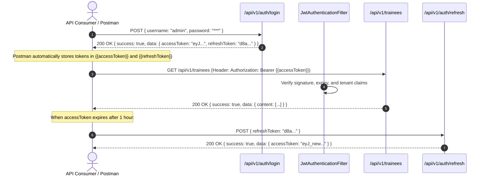

# SIH-26135 Backend Developer Onboarding & Integration Guide

**Version**: `v1.0.0-PROD` (Enterprise Hardened)  
**Target Environment**: Local-PC Development, API Integration, and Demonstration  
**Applicability**: Backend Engineers, Frontend Integrators, API Consumers, System Evaluators  
**Last Updated**: November 2026 (Phase 29.10)

---

## Table of Contents

1. [Executive Summary & Architecture Overview](#1-executive-summary--architecture-overview)
2. [Prerequisites & Toolchain](#2-prerequisites--toolchain)
3. [Local Development Environment Setup](#3-local-development-environment-setup)
4. [Database Provisioning & Invariant Protection](#4-database-provisioning--invariant-protection)
5. [Configuration & Environment Variables](#5-configuration--environment-variables)
6. [Authentication & Authorization Lifecycle](#6-authentication--authorization-lifecycle)
7. [API Contract Standards & Envelope Architecture](#7-api-contract-standards--envelope-architecture)
8. [Comprehensive Error Code Glossary](#8-comprehensive-error-code-glossary)
9. [Integration Walkthroughs: File Uploads & Streaming Exports](#9-integration-walkthroughs-file-uploads--streaming-exports)
10. [Postman Collection & Automated Validation Tooling](#10-postman-collection--automated-validation-tooling)
11. [Insomnia REST Client Interoperability](#11-insomnia-rest-client-interoperability)
12. [Client SDK Generation via OpenAPI Generator](#12-client-sdk-generation-via-openapi-generator)
13. [Troubleshooting & Verification Matrix](#13-troubleshooting--verification-matrix)

---

## 1. Executive Summary & Architecture Overview

The **SIH-26135 Analytics Backend** is an enterprise-grade Spring Boot 3 service designed for vocational education, skill tracking, longitudinal trainee employment verification, and analytics across Indian state/national skilling ecosystems.

### Core Architectural Pillars

- **Framework**: Spring Boot `3.4.10` / Spring Framework `6.2.x`
- **Language / Runtime**: Java `17` (LTS)
- **Persistence**: Spring Data JPA / Hibernate `6.6.x` backed by MySQL `8.0`
- **Security**: Stateless Spring Security `6.4.x` with HMAC-SHA256 Bearer JWTs, DPDP Act 2023 consent boundaries, and strict tenant isolation
- **API Surface**: 386 verified production operations across 250 paths, partitioned into 5 mutually disjoint domain groups
- **Documentation**: OpenAPI 3.1 specifications and interactive Swagger UI (controlled via the `local-demo` profile)
- **Integration Tooling**: Automated Postman v2.1.0 collection with contract validation scripts and zero hardcoded credentials

```
+-----------------------------------------------------------------------------------+
|                           API Consumer Layer                                      |
|    [Postman Collection]     [Insomnia Client]     [Generated TypeScript/Java SDK] |
+-----------------------------------------------------------------------------------+
                                         |
                                         v HTTP / JSON / CSV
+-----------------------------------------------------------------------------------+
|                               Spring Security                                     |
|    - JwtAuthenticationFilter (HMAC-SHA256)     - TenantContextResolutionFilter    |
|    - Brute-Force Rate Limiting (Bucket4j)     - DPDP 2023 Consent Guard           |
+-----------------------------------------------------------------------------------+
                                         |
                                         v
+-----------------------------------------------------------------------------------+
|                        5 Logical Production Groups                                |
|  1. Core Domain      2. Workflows       3. Analytics &     4. Operations &  5. Comm &     |
|     & Master Data       Engines            Exports            Audit Logs       Webhooks   |
+-----------------------------------------------------------------------------------+
                                         |
                                         v
+-----------------------------------------------------------------------------------+
|                         Persistence Layer (MySQL 8.0)                             |
|       Catalog: SIH26135_TEST (Local Dev & Verification)                           |
+-----------------------------------------------------------------------------------+
```

---

## 2. Prerequisites & Toolchain

The backend is engineered to run directly on standard developer workstations (Windows, macOS, or Linux) with zero mandatory cloud dependencies or container runtimes.

| Component | Minimum Version | Verified Version | Purpose |
| :--- | :--- | :--- | :--- |
| **Java JDK** | OpenJDK 17 | Eclipse Temurin 17.0.12 | Core backend runtime |
| **Build Tool** | Maven 3.8+ | Apache Maven 3.9.9 | Dependency resolution & compilation |
| **Database** | MySQL 8.0+ | MySQL Community Server 8.0.39 | Relational datastore & fulltext search |
| **Python** | Python 3.9+ | Python 3.11.x | Scripting, collection generation & verification |
| **API Client** | Postman v10+ / Insomnia v9+ | Postman Desktop 11.x | Integration, test execution, demonstration |

> [!IMPORTANT]
> **Docker is strictly optional.** All build commands, integration scripts, and database verifications run natively on the host workstation.

---

## 3. Local Development Environment Setup

### 3.1 Clone & Repository Structure

```powershell
# Navigate to the project root
cd E:\project

# Inspect primary directories
Get-ChildItem -Path .
# backend/           -> Spring Boot application source code and tests
# docs/              -> Architecture documentation, integration guides, and OpenAPI specs
# docs/openapi/      -> 14 generated OpenAPI 3.1 JSON/YAML contract specifications
# docs/integration/  -> Postman collection, environment JSON, generation and verification scripts
```

### 3.2 Compilation & Dependency Resolution

Build the Maven backend artifact without running test suites to verify the toolchain:

```powershell
mvn -f backend/pom.xml clean compile
```

### 3.3 Running the Application Locally

The application supports profile-based configuration. For local development and demonstration with Swagger UI and OpenAPI documentation enabled:

```powershell
# Run with the local-demo profile (enables Swagger UI at /swagger-ui/index.html)
mvn -f backend/pom.xml spring-boot:run -Dspring-boot.run.profiles=local-demo
```

For headless backend execution with documentation endpoints securely disabled by default:

```powershell
mvn -f backend/pom.xml spring-boot:run
```

When started, the backend binds to port `8080`.

---

## 4. Database Provisioning & Invariant Protection

### 4.1 Database Configuration

The application uses MySQL 8.0. For development and testing, always use the dedicated test catalog `SIH26135_TEST`.

```sql
-- Connect to local MySQL instance
CREATE DATABASE IF NOT EXISTS SIH26135_TEST CHARACTER SET utf8mb4 COLLATE utf8mb4_unicode_ci;
```

### 4.2 Critical Production Invariants

To maintain data integrity and pass security audit batteries, local test executions must preserve authoritative baseline records:

1. **Authoritative Trainee**: ID `1005143L` must have exactly 1 trainee record and 5 DPDP consents.
2. **Root Administrator**: User ID `1L` with role `ROLE_ADMIN` must exist.
3. **Transient Test Isolation**: Any test fixtures generated within synthetic ID ranges `99710..99799` must be cleaned up post-test.
4. **Target Isolation**: Under no circumstances should test or dev runs write to the production catalog `sih26135`.

Verify invariants anytime using:

```powershell
python -c "
import mysql.connector
conn = mysql.connector.connect(host='localhost', user='root', password='ChangeMeInLocalEnv!', database='SIH26135_TEST')
cur = conn.cursor()
cur.execute('SELECT COUNT(*) FROM trainees WHERE id = 1005143')
print('Trainee 1005143 count:', cur.fetchone()[0])
conn.close()
"
```

---

## 5. Configuration & Environment Variables

All critical operational parameters can be customized via environment variables or properties.

| Variable Name | Default Value (`application.properties`) | Local Demo Profile (`local-demo`) | Purpose & Security Guidance |
| :--- | :--- | :--- | :--- |
| `SPRING_DATASOURCE_URL` | `jdbc:mysql://localhost:3306/SIH26135_TEST` | Same | JDBC connection string |
| `SPRING_DATASOURCE_USERNAME` | `root` | Same | Database user |
| `SPRING_DATASOURCE_PASSWORD` | `""` | Provided locally | Database password |
| `JWT_SECRET` | `404E635266556A586E3272357538782F413F4428472B4B6250645367566B5970` | Same | 256-bit secret key for HMAC-SHA256 token signing |
| `JWT_EXPIRATION_MS` | `3600000` (1 hour) | `3600000` | Access token lifespan |
| `JWT_REFRESH_EXPIRATION_MS`| `86400000` (24 hours) | `86400000` | Refresh token lifespan |
| `API_DOCS_ENABLED` | `false` | `true` | Exposes raw OpenAPI JSON `/v3/api-docs/**` |
| `SWAGGER_UI_ENABLED` | `false` | `true` | Exposes interactive Swagger UI at `/swagger-ui/index.html` |
| `MAX_FILE_SIZE` | `10MB` | `10MB` | Maximum file upload size for bulk ingestion |

---

## 6. Authentication & Authorization Lifecycle

The API utilizes stateless Bearer JWT authentication. All business endpoints require a valid token in the `Authorization` HTTP header.

```
Authorization: Bearer <accessToken>
```

### 6.1 Authentication Workflow



### 6.2 Key Security Controls

1. **Account Lockout Protection**: 5 consecutive failed login attempts lock the target account for 15 minutes (`ACCOUNT_LOCKED`).
2. **Brute-Force Rate Limiting**: The login endpoint is rate-limited to 5 requests per minute per IP address (`RATE_LIMIT_EXCEEDED`).
3. **Role-Based Access Control (RBAC)**:
   - `ROLE_ADMIN`: Unrestricted administrative and system governance access.
   - `ROLE_TRAINING_PROVIDER`: Scoped to provider's assigned centers and batches.
   - `ROLE_ASSESSOR`: Assessment scheduling and marks recording.
   - `ROLE_EMPLOYER`: Placement recording and longitudinal retention confirmations.
   - `ROLE_TRAINEE`: Self-service portal access restricted strictly to own records via DPDP consent check.

---

## 7. API Contract Standards & Envelope Architecture

### 7.1 Standard Response Envelope (`ApiResponse<T>`)

Every standard JSON endpoint wraps data in the canonical `ApiResponse<T>` envelope:

```json
{
  "success": true,
  "code": "OPERATION_SUCCESS",
  "message": "Resource retrieved successfully",
  "data": {
    "id": 1005143,
    "fullName": "Aarav Sharma",
    "email": "trainee@example.org"
  },
  "timestamp": "2026-11-20T10:15:30.123Z",
  "path": "/api/v1/trainees/1005143",
  "correlationId": "c8f9b2a1-0000-4000-a000-000000000001"
}
```

### 7.2 Paginated Response Envelope (`PagedResponse<T>`)

List endpoints return data inside `ApiResponse<PagedResponse<T>>`:

```json
{
  "success": true,
  "code": "OPERATION_SUCCESS",
  "message": "Page retrieved successfully",
  "data": {
    "content": [
      { "id": 1, "name": "Batch Alpha" },
      { "id": 2, "name": "Batch Beta" }
    ],
    "page": 0,
    "size": 20,
    "totalElements": 42,
    "totalPages": 3,
    "first": true,
    "last": false,
    "hasNext": true,
    "hasPrevious": false
  },
  "timestamp": "2026-11-20T10:15:30.123Z",
  "path": "/api/v1/batches",
  "correlationId": "c8f9b2a1-0000-4000-a000-000000000002"
}
```

### 7.3 Sanitized Error Envelope (`ErrorResponse`)

Errors return RFC 7807-aligned `ErrorResponse` envelopes with **zero internal stack trace or SQL leakage**:

```json
{
  "status": 404,
  "error": "Not Found",
  "code": "TRAINEE_NOT_FOUND",
  "message": "Trainee with identifier 9999999 was not found",
  "path": "/api/v1/trainees/9999999",
  "timestamp": "2026-11-20T10:15:30.123Z",
  "correlationId": "c8f9b2a1-0000-4000-a000-000000000003",
  "details": [
    "No active or archived record matches the supplied identifier"
  ]
}
```

### 7.4 Streaming & Export Contract

Endpoints under `/api/v1/analytics/export/**` stream large CSV or raw JSON exports using `StreamingResponseBody`.
- **Response Headers**: `Content-Type: text/csv;charset=UTF-8`, `Content-Disposition: attachment; filename="..."`
- **Envelope**: Direct byte stream; **no JSON wrapper is applied**.
- **Privacy Assurance**: Statistical Disclosure Control (SDC) with $k \ge 5$ cell suppression and anti-differencing noise is enforced.

---

## 8. Comprehensive Error Code Glossary

The backend provides deterministic, machine-readable error codes in the `code` field of `ErrorResponse`.

| Error Code | HTTP Status | Root Cause | Client Resolution |
| :--- | :--- | :--- | :--- |
| `INVALID_CREDENTIALS` | 401 | Invalid username or password | Verify credentials; check case sensitivity |
| `ACCOUNT_LOCKED` | 423 | 5 failed login attempts exceeded | Wait 15 minutes for lockout window to elapse |
| `TOKEN_EXPIRED` | 401 | Bearer JWT has expired | Call `POST /api/v1/auth/refresh` with `refreshToken` |
| `INSUFFICIENT_PERMISSIONS` | 403 | User role lacks authority for route | Request role elevation or correct tenant context |
| `DPDP_CONSENT_REQUIRED` | 403 | Trainee consent missing under DPDP 2023 | Obtain electronic consent via `/api/v1/trainees/{id}/consents` |
| `TRAINEE_NOT_FOUND` | 404 | Trainee record does not exist | Verify ID in master catalog |
| `TRAINEE_MISMATCH` | 400 | Payload identifier diverges from URI path | Align ID in request body with path variable |
| `DUPLICATE_IDENTIFIER` | 409 | Unique constraint violated (e.g. Aadhaar hash) | Check existing records before resubmitting |
| `VALIDATION_FAILED` | 400 | DTO `@Valid` annotation failure | Inspect `details` array for specific field violations |
| `FILE_SIZE_LIMIT_EXCEEDED`| 413 | Upload exceeds 10MB limit | Compress or split file before upload |
| `UNSUPPORTED_MEDIA_TYPE` | 415 | Content-Type header invalid | Provide `multipart/form-data` or `application/json` |
| `RATE_LIMIT_EXCEEDED` | 429 | Rate limit threshold exceeded | Implement exponential backoff retry |
| `AUDIT_LOG_IMMUTABLE` | 405 | Attempted PUT/DELETE on immutable audit log | Audit logs are write-once append-only |

---

## 9. Integration Walkthroughs: File Uploads & Streaming Exports

### 9.1 Bulk Data Ingestion (Multipart File Upload)

The bulk ingestion API processes CSV staging batches asynchronously.

#### cURL Example
```bash
curl -X POST "http://localhost:8080/api/v1/operations/ingestion/upload" \
  -H "Authorization: Bearer $ACCESS_TOKEN" \
  -F "file=@trainees_batch_2026.csv;type=text/csv"
```

#### JavaScript (Fetch API) Example
```javascript
const formData = new FormData();
formData.append('file', fileBlob, 'trainees_batch_2026.csv');

const response = await fetch('http://localhost:8080/api/v1/operations/ingestion/upload', {
  method: 'POST',
  headers: {
    'Authorization': `Bearer ${accessToken}`
  },
  body: formData
});

const result = await response.json();
console.log('Ingestion Batch ID:', result.data.batchId);
```

#### Python (Requests) Example
```python
import requests

url = "http://localhost:8080/api/v1/operations/ingestion/upload"
headers = {"Authorization": f"Bearer {access_token}"}
files = {"file": ("trainees_batch_2026.csv", open("trainees_batch_2026.csv", "rb"), "text/csv")}

response = requests.post(url, headers=headers, files=files)
response.raise_for_status()
print("Batch ID:", response.json()["data"]["batchId"])
```

### 9.2 Memory-Bounded Streaming CSV Export

#### cURL Example
```bash
curl -X GET "http://localhost:8080/api/v1/analytics/export/trainees/csv?stateId=10" \
  -H "Authorization: Bearer $ACCESS_TOKEN" \
  -o "trainees_state_10.csv"
```

#### Python (Streaming to Disk) Example
```python
import requests

url = "http://localhost:8080/api/v1/analytics/export/trainees/csv"
headers = {"Authorization": f"Bearer {access_token}"}
params = {"stateId": 10}

with requests.get(url, headers=headers, params=params, stream=True) as r:
    r.raise_for_status()
    with open("trainees_export.csv", "wb") as f:
        for chunk in r.iter_content(chunk_size=8192):
            f.write(chunk)
print("Export streamed successfully without memory buffering.")
```

---

## 10. Postman Collection & Automated Validation Tooling

The integration suite provides an enterprise Postman collection v2.1.0 covering **100% of the 386 production operations** across 250 paths.

### 10.1 Artifact Locations

- **Collection**: `docs/integration/sih26135-postman-collection.json`
- **Environment**: `docs/integration/sih26135-local.postman_environment.json`
- **Generator**: `docs/integration/generate-postman-collection.py`
- **Verifier**: `docs/integration/verify-collection.py`

### 10.2 Importing into Postman

1. Open Postman.
2. Click **Import** (top left).
3. Select both `sih26135-postman-collection.json` and `sih26135-local.postman_environment.json`.
4. In the top-right environment selector, choose **SIH-26135 Local Environment**.
5. Set the `password` variable to your local test password.

### 10.3 Automated Authentication Execution

1. Navigate to:  
   `1. Core Domain & Master Data` -> `Authentication` -> `Login`
2. Click **Send**.
3. The embedded test script automatically extracts `accessToken` and `refreshToken` and saves them to your Postman environment:
   ```javascript
   pm.environment.set("accessToken", json.data.accessToken);
   pm.environment.set("refreshToken", json.data.refreshToken);
   ```
4. All subsequent requests in the collection automatically inherit `Authorization: Bearer {{accessToken}}`.

### 10.4 Automated Verification Script

To independently verify collection integrity, 1:1 operation parity, and test coverage:

```powershell
python E:\project\docs\integration\verify-collection.py
```

Expected output:
```
Total Postman requests found: 386
Total OpenAPI operations found: 386
OK: Exact operation count match (386 == 386)
OK: 100% of operations have automated response contract validation scripts
VERIFICATION RESULT: ALL CHECKS PASSED (0 FAILURES)
```

---

## 11. Insomnia REST Client Interoperability

Insomnia users can integrate using either of two fully compatible formats:

### Method A: Direct OpenAPI 3.1 Document Import (Recommended)

1. Open Insomnia.
2. Navigate to **Preferences** -> **Data** -> **Import Data**.
3. Choose **From File** and select `docs/openapi/openapi-0-all-apis.json` (or any of the 5 grouped specs in `docs/openapi/`).
4. Select **OpenAPI 3.1** format. Insomnia generates a structured workspace with documentation, type definitions, and request bodies.

### Method B: Postman Collection v2.1 Import

1. In Insomnia, click **Import**.
2. Select `docs/integration/sih26135-postman-collection.json`.
3. Insomnia automatically parses folders, queries, headers, and request bodies into native Insomnia request items.

---

## 12. Client SDK Generation via OpenAPI Generator

Client SDKs can be generated for web, mobile, or backend microservices using the official OpenAPI Generator CLI.

### 12.1 Prerequisites

Ensure you have `@openapitools/openapi-generator-cli` installed:

```bash
npm install -g @openapitools/openapi-generator-cli
```

### 12.2 TypeScript / Axios Client (Frontend / Node.js)

```bash
openapi-generator-cli generate \
  -i docs/openapi/openapi-0-all-apis.json \
  -g typescript-axios \
  -o ./generated-client/typescript \
  --additional-properties=supportsES6=true,npmName=@sih26135/api-client
```

### 12.3 Java 17 Client (Spring / Android Microservice)

```bash
openapi-generator-cli generate \
  -i docs/openapi/openapi-0-all-apis.json \
  -g java \
  -o ./generated-client/java \
  --additional-properties=java8=false,dateLibrary=java8-localdatetime,library=resttemplate
```

### 12.4 Python Client (Data Science / Analytics)

```bash
openapi-generator-cli generate \
  -i docs/openapi/openapi-0-all-apis.json \
  -g python \
  -o ./generated-client/python \
  --additional-properties=packageName=sih26135_client
```

---

## 13. Troubleshooting & Verification Matrix

| Symptom | Diagnostic Step | Permanent Fix |
| :--- | :--- | :--- |
| **HTTP 404 on `/swagger-ui/index.html`** | Check active Spring profile | Pass `--spring.profiles.active=local-demo` or set `SWAGGER_UI_ENABLED=true`. Disabled by default for security. |
| **HTTP 401 Unauthorized across all requests** | Inspect `{{accessToken}}` in Postman environment | Run the `Login` request in Postman first to capture a fresh JWT token. |
| **HTTP 403 Forbidden with `DPDP_CONSENT_REQUIRED`** | Inspect trainee consent status | Trainee records require valid consent. Invoke `POST /api/v1/trainees/{id}/consents` before querying PII fields. |
| **HTTP 429 Rate Limit Exceeded** | Inspect login retry frequency | The authentication endpoint enforces 5 req/min. Pause testing or use cached tokens. |
| **HTTP 413 File Size Exceeded on upload** | Check file size | Staging file exceeds 10MB limit. Split CSV into smaller chunks. |
| **MySQL Connection Refused on startup** | Check `localhost:3306` status | Start MySQL service: `net start MySQL80` or verify credentials in `application.properties`. |

---
*End of Developer Onboarding & Integration Guide.*
