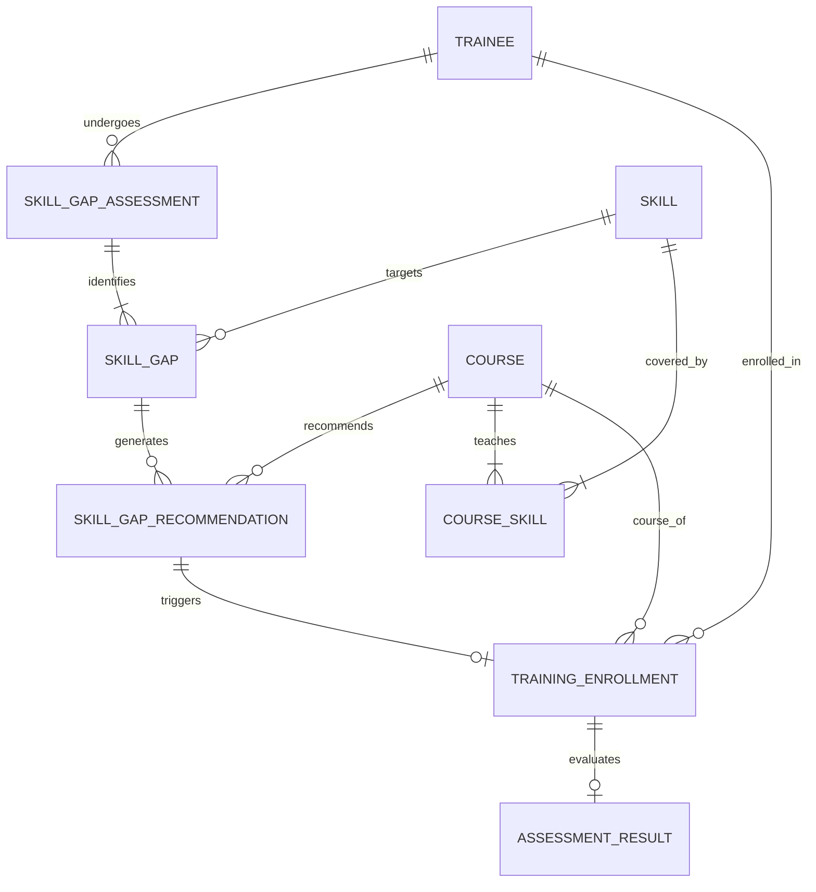
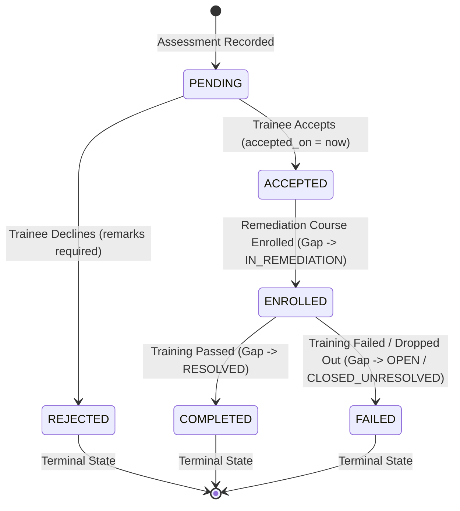
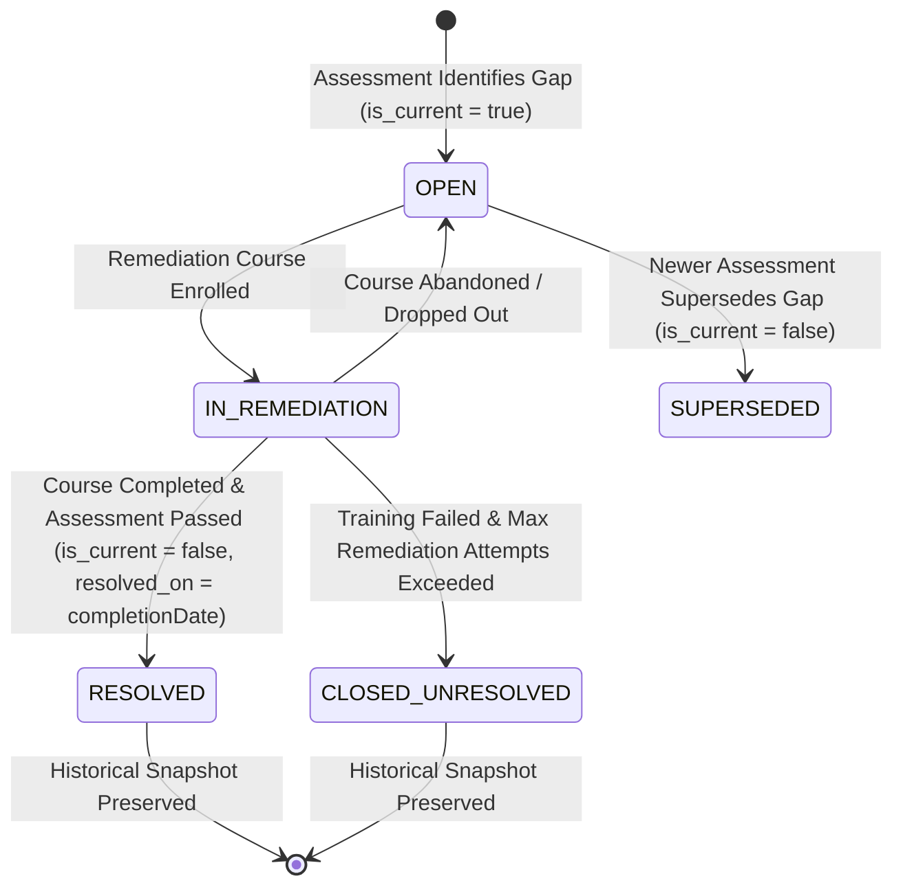

# Phase 25.7 — Skill-Gap Remediation Workflow: Architecture & Subphase Roadmap

**Project:** SIH 26135 — Longitudinal Tracking & Impact Analysis  
**Phase:** 25.7 — Skill-Gap Remediation Workflow  
**Domain Area:** Skill-Gap Assessment, Recommendation Lifecycle, Remediation Enrollment, and Training Completion Resolution  
**Database Schema:** `SIH26135_TEST` / `SIH26135` (ddl-auto=validate, strictly frozen)  
**Status:** **PLANNING & SPECIFICATION FREEZE (NO CODE CHANGES YET)**

---

## 1. Executive Summary & Workflow Objectives

Phase 25.7 formalizes the end-to-end cross-domain workflow that connects trainee skill-gap assessments with targeted remediation training and outcome tracking.

### Core Objectives:
1. **Assessment to Remediation Flow:** Orchestrate seamless end-to-end flow from initial diagnostic assessment, gap item identification, course recommendation, trainee acceptance, and remediation enrollment.
2. **Strict Multi-Entity Link Integrity:** Enforce rigorous relational guards between Trainee, Required Skill, Assessment, Recommended Course, and Course-Skill mappings.
3. **Recommendation Lifecycle State Machine:** Define and enforce deterministic transitions for recommendations: `PENDING` $\rightarrow$ `ACCEPTED` / `REJECTED` $\rightarrow$ `ENROLLED` $\rightarrow$ `COMPLETED` / `ABANDONED`.
4. **Training Completion & Gap Resolution:** Synchronize course completion with gap status: when remediation training is completed with a passing assessment result, transition the linked skill gap from `IN_REMEDIATION` to `RESOLVED`, record `resolved_on`, and set `is_current = false`.
5. **Historical Immutability & Audit Trail:** Guarantee that historical assessments, past observations, and resolved gaps are strictly preserved and never mutated or deleted, maintaining a longitudinal timeline for every trainee.

---

## 2. Domain Entities & Database Invariants

### 2.1 Database Tables Involved:
- `skill_gap_assessments`: Top-level assessment container (`trainee_id`, `assessment_date`, `status_id`).
- `skill_gaps`: Specific gap items identified (`trainee_id`, `skill_id`, `skill_gap_assessment_id`, `skill_gap_status_id`, `is_current`, `current_gap_key`, `identified_on`, `resolved_on`).
  - *Constraint `uk_skill_gaps_current`:* `(trainee_id, skill_id, current_gap_key)` where `current_gap_key` is a generated virtual column (`CASE WHEN is_current = 1 THEN 1 ELSE NULL END`). Guarantees only one active gap per skill per trainee.
- `skill_gap_recommendations`: Proposed remediation actions (`skill_gap_id`, `skill_gap_action_type_id`, `recommended_course_id`, `is_accepted_flag`, `accepted_on`, `remarks`).
- `ref_skill_gap_status`: `OPEN` (1), `IN_REMEDIATION` (2), `RESOLVED` (3), `CLOSED_UNRESOLVED` (4), `SUPERSEDED` (5).
- `ref_skill_gap_action_type`: `RECOMMEND_COURSE` (1, requires course), `REASSESSMENT` (2), `ON_THE_JOB` (3), `COUNSELLING` (4), `SELF_LEARNING` (5), `OTHER` (6).
- `course_skills`: Relational bridge verifying that a recommended course actually provides the missing skill.
- `training_enrollments`: The remediation enrollment entity (`trainee_id`, `course_id`, `is_completed_flag`, `actual_completion_date`).
- `assessment_results`: Certification outcome (`trainee_id`, `is_pass_flag`).

---

## 3. Workflow State Machines

### 3.1 Recommendation Lifecycle Transitions

### 3.2 Skill-Gap Status Lifecycle

---

## 4. Phase 25.7 Detailed Subphase Breakdown

### Subphase 25.7.1: Domain Linkage & Multi-Entity Relational Integrity Guards
**Focus:** Strict relational cross-checks between Trainee, Required Skill, Assessment, and Recommended Course.
- **Rules & Validations:**
  1. *Trainee Homogeneity:* The trainee specified in the assessment request, each gap item, each recommendation, and the resulting enrollment must match identically. Reject any mismatched trainee ID with `SKILL_GAP_TRAINEE_MISMATCH`.
  2. *Assessment Ownership:* Any gap or recommendation referenced in remediation workflows must belong to the active assessment (`SKILL_GAP_ASSESSMENT_MISMATCH`).
  3. *Skill-Course Relevance Guard:* If a recommendation specifies `skill_gap_action_type = RECOMMEND_COURSE`, verify that the `recommended_course_id` teaches the `skill_id` of the gap via `course_skills` repository query. Reject irrelevant course recommendations with `COURSE_SKILL_MISMATCH`.
  4. *Active Course & Skill Verification:* Verify that the referenced Skill and Course exist and are active (not soft-deleted or discontinued).

### Subphase 25.7.2: Recommendation Decision Lifecycle & State Transitions
**Focus:** Explicit state machine implementation for recommendation acceptance, rejection, and transition validation.
- **Rules & Validations:**
  1. *Acceptance Transition (`acceptRecommendation`):*
     - Prerequisite: Recommendation must be in `PENDING` state (`isAcceptedFlag == false` and not previously rejected).
     - State mutation: Set `isAcceptedFlag = true`, `acceptedOn = LocalDate.now()`, optional trainee acceptance notes.
     - Uniqueness: Ensure trainee does not have duplicate accepted recommendations for the same skill gap.
  2. *Rejection Transition (`rejectRecommendation`):*
     - Prerequisite: Recommendation must be in `PENDING` state.
     - State mutation: `isAcceptedFlag = false`, requires mandatory non-blank `remarks` explaining rejection reason.
     - Terminality: A rejected recommendation cannot subsequently be enrolled.
  3. *Transition Guards:* Fail-closed error mapping (`INVALID_STATE_TRANSITION`) for attempts to accept an already rejected recommendation or re-reject an enrolled recommendation.

### Subphase 25.7.3: Remediation Enrollment Orchestration
**Focus:** Coordinated creation of `TrainingEnrollment` from an accepted recommendation and gap status update.
- **Rules & Validations:**
  1. *Enrollment Eligibility:* Trainee can only be enrolled in remediation training if the recommendation is explicitly `ACCEPTED` (`isAcceptedFlag == true`).
  2. *Course Alignment:* The course in the enrollment request must match the `recommended_course_id`.
  3. *Transactional Gap Transition:* In the same database transaction:
     - Create and persist `TrainingEnrollment`.
     - Update `SkillGap` status from `OPEN` to `IN_REMEDIATION` (status code: `IN_REMEDIATION`).
     - Update recommendation status/remarks referencing the newly created enrollment ID.
  4. *Double-Enrollment Prevention:* If the gap is already `IN_REMEDIATION` or `RESOLVED`, reject duplicate remediation enrollment attempts with `DUPLICATE_REMEDIATION_ENROLLMENT`.

### Subphase 25.7.4: Training Completion & Skill-Gap Status Synchronization
**Focus:** Synchronization hook between training outcome events and skill-gap resolution.
- **Rules & Validations:**
  1. *Dual-Condition Trigger:* Both `TrainingEnrollment.isCompletedFlag == true` AND `AssessmentResult.isPassFlag == true` are strictly required to resolve a skill gap.
  2. *Target Gap Resolution:*
     - Query all `IN_REMEDIATION` gaps for the trainee that match the skills covered by the completed course (`course_skills`).
     - Transition matching gaps to `RESOLVED` (status code: `RESOLVED`, `is_resolved_flag = true`, `is_open_flag = false`).
     - Set `resolved_on = enrollment.actualCompletionDate` (or `LocalDate.now()`).
     - Set `is_current = false` to archive the gap and free the `uk_skill_gaps_current` slot.
  3. *Failed / Incomplete Outcome Handling:*
     - If trainee fails the certification exam (`isPassFlag == false`) or drops out, the gap is NOT resolved.
     - Provide option to return gap status from `IN_REMEDIATION` back to `OPEN` for re-remediation or transition to `CLOSED_UNRESOLVED` after maximum failed attempts.

### Subphase 25.7.5: Historical Immutability, Snapshotting & Profile Retrieval
**Focus:** Preserving assessment history and providing comprehensive longitudinal skill gap reporting.
- **Rules & Validations:**
  1. *Immutability Invariant:* Past `SkillGapAssessment`, `SkillGap`, and `SkillGapObservation` records must NEVER be updated or deleted when new assessments are conducted or gaps are resolved.
  2. *Historical Snapshotting:* A trainee who had a Python gap in Jan 2026 (resolved in Mar 2026) and is later assessed with an Advanced Python gap in Dec 2026 maintains both records with their original proficiency levels and dates.
  3. *Longitudinal Profile Aggregation (`getTraineeSkillGapProfile`):*
     - Aggregate all historical assessments ordered chronologically.
     - Partition gaps into Active (`is_current = true`, `OPEN` or `IN_REMEDIATION`) and Historical/Resolved (`is_current = false`, `RESOLVED`, `SUPERSEDED`, `CLOSED_UNRESOLVED`).
     - Return linked recommendations and remediation enrollment outcomes.

### Subphase 25.7.6: REST API Hardening & Security Authorization
**Focus:** Expose and secure the workflow operations in `SkillGapRemediationWorkflowController`.
- **Endpoints to Support / Expand:**
  1. `POST /api/v1/workflows/skill-gap-remediation/record-assessment-with-gaps` (Record assessment, gaps, initial recommendations)
  2. `POST /api/v1/workflows/skill-gap-remediation/recommendations/{id}/decision` (Accept or Reject recommendation)
  3. `POST /api/v1/workflows/skill-gap-remediation/enroll-remediation-course` (Enroll trainee into remediation course)
  4. `POST /api/v1/workflows/skill-gap-remediation/resolve-remediation` (Manual / trigger-based gap resolution verification)
  5. `GET /api/v1/workflows/skill-gap-remediation/profile?traineeId={id}` (Longitudinal trainee skill gap profile)
- **Security & Validation Controls:**
  - Strict `@PreAuthorize("hasAnyAuthority('assessment.manage', 'enrollment.manage')")`.
  - Pure body POST endpoints reject query parameters with `UNSUPPORTED_PARAMETER`.
  - Unknown controller / DTO classes fail closed to sanitized HTTP 500 responses via `GlobalExceptionHandler`.
  - Input validation annotations (`@Valid`, `@NotNull`, `@Min`) on all workflow request DTOs.

### Subphase 25.7.7: End-to-End Regression Testing & Database Isolation Verification
**Focus:** Full suite verification of the workflow against `SIH26135_TEST`.
- **Verification Deliverables:**
  1. Unit tests for `SkillGapRemediationWorkflowServiceImpl` covering all valid and invalid state transitions.
  2. Integration tests for `SkillGapRemediationWorkflowController` exercising MockMvc with authentication and role tokens.
  3. Real database integration tests verifying that `uk_skill_gaps_current` correctly permits new gaps after historical gaps are resolved.
  4. Complete test suite verification (`mvn test`) guaranteeing 0 failures, 0 errors, and zero production database leakage.

---

## 5. Execution Matrix & Dependencies

| Subphase | Name | Core Components | Key Dependencies |
| :--- | :--- | :--- | :--- |
| **25.7.1** | Domain Linkage & Entity Integrity | `SkillGapRemediationWorkflowServiceImpl`, `CourseSkillRepository` | Entity repositories, DTO mappers |
| **25.7.2** | Recommendation State Machine | Recommendation decision API & Service methods | `SkillGapRecommendationRepository` |
| **25.7.3** | Remediation Enrollment Orchestration | `enrollTraineeInRemediationCourse` | `TrainingEnrollmentService`, `SkillGapService` |
| **25.7.4** | Training Completion & Gap Resolution | Synchronization hooks with `TrainingOutcomeWorkflow` | `TrainingOutcomeWorkflowServiceImpl` |
| **25.7.5** | History Immutability & Profile Query | `getTraineeSkillGapProfile`, snapshot queries | `SkillGapAssessmentRepository` |
| **25.7.6** | REST API & Security Hardening | `SkillGapRemediationWorkflowController`, DTOs | `GlobalExceptionHandler`, Spring Security |
| **25.7.7** | End-to-End Testing & Verification | Focused and full Surefire test suite | `SIH26135_TEST`, `run-tests.ps1` |

---

## 6. Implementation Guardrails (Mandatory)

1. **No Production Database Fallback:** All tests and verifications must strictly target `SIH26135_TEST`.
2. **DDL Freezing:** Schema tables (`skill_gaps`, `skill_gap_assessments`, etc.) are frozen (`ddl-auto=validate`). Zero DDL alterations or migration scripts.
3. **Fail-Closed Security:** Mismatched trainees, orphaned recommendations, or invalid status transitions must throw explicit `BadRequestException` or `ResourceNotFoundException`.
4. **No Code Edits During Planning:** This phase plan is frozen and saved prior to initiating any code modifications.
