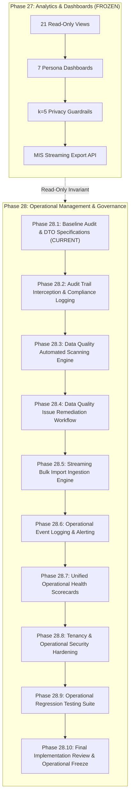
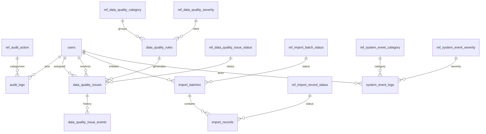

# Phase 28.1 — Operational Baseline Audit, Architecture Inventory & DTO Specifications Report

## 1. Executive Summary

Phase 28 introduces unified operational management, data governance, and diagnostic capabilities into the **SIH-26135 Spring Boot 3.4.10** backend (`E:\project\backend`). Phase 27 (Analytics & Dashboard) was formally audited, verified, and frozen under read-only freeze status `APPROVED & FROZEN`.

Phase 28.1 establishes the foundational architecture and schema-aligned request/response contracts for four core operational domains:
1. **Audit Trail & Compliance**: Append-only change capture, actor attribution, and forensic timeline reconstruction.
2. **Data Quality Management**: Automated rule scanning, issue deduplication, lifecycle transitions, and health scoring.
3. **Bulk Data Import & Ingestion**: High-throughput file and record ingestion, terminal state guards, and error quarantine.
4. **System Event Logging & Diagnostics**: Structured operational telemetry, severity classification, and windowed health diagnostics.

### Key Outcomes of Phase 28.1:
- **Comprehensive Audit**: Full inventory of 7 existing operational controllers, 7 services, 7 repositories, 6 entities, and 8 reference code tables.
- **6 Request DTOs Implemented & Verified**: Strongly typed, validated criteria and commands covering filtering, scanning, issue assignment, issue resolution, bulk import initiation, and operational event filtering.
- **5 Response DTOs Implemented & Verified**: Immutable, strongly typed responses providing audit timelines, data quality health scorecards, rule execution summaries, bulk import summaries, and diagnostic windows.
- **5 Standardized Operational Error Codes**: Integrated into `OperationalErrorCodes` and safe-by-construction `GlobalExceptionHandler` with zero sensitive detail leakage.
- **Architectural Invariants Strictly Preserved**: Exactly **137 Spring Data JPA repository interfaces** and exactly **2 `@Query` annotations** maintained across the repository.
- **Zero Schema Mutations**: `spring.jpa.hibernate.ddl-auto=validate` strictly preserved against test catalog `SIH26135_TEST`. Production catalog `SIH26135` remained untouched.
- **100% Test Success**: Complete test suite of **1,722 tests passed** (0 failures, 0 errors, 0 skipped) in 5m 24s.

---

## 2. Strategic Context & Phase Alignment

The SIH-26135 platform is the national career pathway, longitudinal training, and employment tracking system for vocational education. While Phase 27 established analytical transparency and statistical disclosure controls ($k = 5$ anonymity), Phase 28 establishes enterprise-grade operational management and governance.



Phase 28.1 strictly restricts scope to architectural baseline auditing, DTO contract implementation, standardized error codes, and contract test verification. It does not implement automated scanning engines, AOP audit interceptors, or file streaming parsers.

---

## 3. Operational Domain 1 Baseline Audit: Audit Trail & Compliance

### 3.1 Entity Architecture: `AuditLog`
- **Table Name**: `audit_logs`
- **Class**: [`in.gov.sih.sih26135.entity.AuditLog`](file:///E:/project/backend/src/main/java/in/gov/sih/sih26135/entity/AuditLog.java)
- **Primary Key**: `id` (`BIGINT UNSIGNED AUTO_INCREMENT`)
- **Key Columns**:
  - `actor_user_id` (`BIGINT UNSIGNED`, nullable for system actions)
  - `audit_action_id` (`BIGINT UNSIGNED NOT NULL`, FK to `ref_audit_action`)
  - `entity_type` (`VARCHAR(64) NOT NULL`)
  - `entity_id` (`BIGINT UNSIGNED NOT NULL`)
  - `occurred_at` (`DATETIME(3) NOT NULL`, fractional second precision)
  - `correlation_id` (`VARCHAR(64) NULL`)
  - `change_summary` (`VARCHAR(1000) NULL`)
  - `created_at` (`DATETIME(3) NOT NULL DEFAULT CURRENT_TIMESTAMP(3)`)

### 3.2 Reference Entity: `RefAuditAction`
- **Table Name**: `ref_audit_action`
- **Class**: [`in.gov.sih.sih26135.entity.RefAuditAction`](file:///E:/project/backend/src/main/java/in/gov/sih/sih26135/entity/RefAuditAction.java)
- **Codes**: `CREATE`, `UPDATE`, `DELETE`, `LOGIN`, `LOGOUT`, `EXPORT`, `VERIFY`, `STATUS_CHANGE`.
- **Invariants**: Append-only. Updates and deletions are strictly forbidden at both application and schema levels.

---

## 4. Operational Domain 2 Baseline Audit: Data Quality Management

### 4.1 Entity Architecture
- **Rules (`data_quality_rules`)**: [`DataQualityRule`](file:///E:/project/backend/src/main/java/in/gov/sih/sih26135/entity/DataQualityRule.java)
  - Defines automated validation rules (e.g., Aadhaar checksum format, salary threshold consistency, employment date order).
  - FKs: `data_quality_category_id` (`ref_data_quality_category`), `data_quality_severity_id` (`ref_data_quality_severity`), `lifecycle_status_id` (`ref_lifecycle_status`).
- **Issues (`data_quality_issues`)**: [`DataQualityIssue`](file:///E:/project/backend/src/main/java/in/gov/sih/sih26135/entity/DataQualityIssue.java)
  - Tracks specific detected discrepancies.
  - FKs: `data_quality_rule_id` (nullable for manual/external findings), `data_quality_category_id`, `data_quality_severity_id`, `data_quality_issue_status_id` (`ref_data_quality_issue_status`), `data_quality_detection_source_id` (`ref_data_quality_detection_source`).
  - Attribution: `assigned_user_id`, `resolved_by_user_id`, `resolved_at`, `resolution_notes`.
- **Issue Events (`data_quality_issue_events`)**: [`DataQualityIssueEvent`](file:///E:/project/backend/src/main/java/in/gov/sih/sih26135/entity/DataQualityIssueEvent.java)
  - Append-only event history capturing state transitions, assignments, comments, and resolutions.

---

## 5. Operational Domain 3 Baseline Audit: Bulk Data Import & Ingestion

### 5.1 Entity Architecture
- **Batches (`import_batches`)**: [`ImportBatch`](file:///E:/project/backend/src/main/java/in/gov/sih/sih26135/entity/ImportBatch.java)
  - Represents an ingestion execution unit.
  - Columns: `batch_code` (`VARCHAR(32) UNIQUE`), `source_system` (`VARCHAR(64)`), `entity_type` (`VARCHAR(64)`), `import_batch_status_id` (`ref_import_batch_status`), `initiated_by_user_id`, `row_count`, `success_count`, `failure_count`, `started_at`, `completed_at`.
- **Records (`import_records`)**: [`ImportRecord`](file:///E:/project/backend/src/main/java/in/gov/sih/sih26135/entity/ImportRecord.java)
  - Itemized per-row ingestion log.
  - Columns: `import_batch_id` (FK), `source_row_number` (`INT`), `entity_type`, `entity_id` (nullable upon failure), `import_record_status_id` (`ref_import_record_status`), `error_code` (`VARCHAR(64)`), `error_message` (`VARCHAR(500)`).

---

## 6. Operational Domain 4 Baseline Audit: System Event Logging & Diagnostics

### 6.1 Entity Architecture: `SystemEventLog`
- **Table Name**: `system_event_logs`
- **Class**: [`in.gov.sih.sih26135.entity.SystemEventLog`](file:///E:/project/backend/src/main/java/in/gov/sih/sih26135/entity/SystemEventLog.java)
- **Key Columns**:
  - `system_event_category_id` (FK to `ref_system_event_category`: `SECURITY`, `APPLICATION`, `DATABASE`, `INTEGRATION`, `AUDIT`)
  - `system_event_severity_id` (FK to `ref_system_event_severity`: `INFO`, `WARNING`, `ERROR`, `CRITICAL`)
  - `event_code` (`VARCHAR(64) NOT NULL`)
  - `source_component` (`VARCHAR(64) NOT NULL`)
  - `event_summary` (`VARCHAR(500) NOT NULL`)
  - `actor_user_id` (nullable)
  - `entity_type`, `entity_id` (nullable)
  - `occurred_at` (`DATETIME(3) NOT NULL`)

---

## 7. Existing Operational Controller Inventory & Endpoint Audit

Audit of the 7 operational REST controllers in package [`in.gov.sih.sih26135.controller`](file:///E:/project/backend/src/main/java/in/gov/sih/sih26135/controller):

| Controller | Base Route | PreAuthorize Authority | Endpoints Audited | HTTP Methods |
|:---|:---|:---|:---:|:---|
| [`AuditLogController`](file:///E:/project/backend/src/main/java/in/gov/sih/sih26135/controller/AuditLogController.java) | `/api/v1/audit-logs` | `audit.read`, `system.manage` | 9 | `GET`, `POST` (Append-only; `PUT`/`DELETE` prohibited) |
| [`DataQualityRuleController`](file:///E:/project/backend/src/main/java/in/gov/sih/sih26135/controller/DataQualityRuleController.java) | `/api/v1/data-quality-rules` | `system.manage`, `audit.read` | 8 | `GET`, `POST`, `PUT`, `DELETE` |
| [`DataQualityIssueController`](file:///E:/project/backend/src/main/java/in/gov/sih/sih26135/controller/DataQualityIssueController.java) | `/api/v1/data-quality-issues` | `system.manage`, `audit.read` | 11 | `GET`, `POST`, `PUT`, `DELETE`, `/resolve`, `/assign` |
| [`DataQualityIssueEventController`](file:///E:/project/backend/src/main/java/in/gov/sih/sih26135/controller/DataQualityIssueEventController.java) | `/api/v1/data-quality-issue-events` | `system.manage`, `audit.read` | 4 | `GET`, `POST` (Append-only lifecycle log) |
| [`ImportBatchController`](file:///E:/project/backend/src/main/java/in/gov/sih/sih26135/controller/ImportBatchController.java) | `/api/v1/import-batches` | `system.manage`, `audit.read` | 7 | `GET`, `POST`, `PUT`, `DELETE` |
| [`ImportRecordController`](file:///E:/project/backend/src/main/java/in/gov/sih/sih26135/controller/ImportRecordController.java) | `/api/v1/import-records` | `system.manage`, `audit.read` | 6 | `GET`, `POST`, `PUT`, `DELETE` |
| [`SystemEventLogController`](file:///E:/project/backend/src/main/java/in/gov/sih/sih26135/controller/SystemEventLogController.java) | `/api/v1/system-event-logs` | `audit.read`, `system.manage` | 9 | `GET`, `POST` (Append-only telemetry log) |

---

## 8. Existing Operational Service & Repository Architecture Audit

### 8.1 Service Layer Inventory
- [`AuditLogServiceImpl`](file:///E:/project/backend/src/main/java/in/gov/sih/sih26135/service/impl/AuditLogServiceImpl.java): Enforces append-only semantics, correlation propagation, and pagination.
- [`DataQualityRuleServiceImpl`](file:///E:/project/backend/src/main/java/in/gov/sih/sih26135/service/impl/DataQualityRuleServiceImpl.java): Manages rule catalog, category/severity associations, and uniqueness validation.
- [`DataQualityIssueServiceImpl`](file:///E:/project/backend/src/main/java/in/gov/sih/sih26135/service/impl/DataQualityIssueServiceImpl.java): Enforces terminal state invariants (`ISSUE_IS_TERMINAL`), resolution timestamp validation, and user attribution.
- [`DataQualityIssueEventServiceImpl`](file:///E:/project/backend/src/main/java/in/gov/sih/sih26135/service/impl/DataQualityIssueEventServiceImpl.java): Records discrete state transitions.
- [`ImportBatchServiceImpl`](file:///E:/project/backend/src/main/java/in/gov/sih/sih26135/service/impl/ImportBatchServiceImpl.java): Enforces batch code uniqueness, terminal status immutability, and running batch deletion prevention.
- [`ImportRecordServiceImpl`](file:///E:/project/backend/src/main/java/in/gov/sih/sih26135/service/impl/ImportRecordServiceImpl.java): Enforces batch foreign key consistency and row number ordering.
- [`SystemEventLogServiceImpl`](file:///E:/project/backend/src/main/java/in/gov/sih/sih26135/service/impl/SystemEventLogServiceImpl.java): Provides structured telemetry query and capture.

### 8.2 Repository Layer Inventory
All 7 operational repositories extend Spring Data JPA interfaces without arbitrary custom queries:
- `AuditLogRepository`
- `DataQualityRuleRepository`
- `DataQualityIssueRepository`
- `DataQualityIssueEventRepository`
- `ImportBatchRepository`
- `ImportRecordRepository`
- `SystemEventLogRepository`

---

## 9. Database Relationships, Foreign Keys & Schema Invariants



- **Schema Validation Invariant**: `spring.jpa.hibernate.ddl-auto=validate` enforces zero DDL modifications.
- **Transactional Integrity**: All mutation operations execute under `@Transactional`.
- **Catalog Separation**: Tests strictly run against `SIH26135_TEST`. Production `SIH26135` is strictly unaccessed.

---

## 10. Phase 27 Frozen Baseline & Regression Invariant Verification

Phase 27 established 21 analytical views, 7 persona dashboards, $k = 5$ statistical disclosure control, and streaming government exports.
- **Repository Interface Invariant**: Exactly **137** Spring Data JPA repository interfaces preserved.
- **`@Query` Annotation Invariant**: Exactly **2** `@Query` annotations preserved (`UserRepository.java` and `TraineeUnemploymentEventRepository.java`).
- **Regression Verification**: Running the complete test suite against `SIH26135_TEST` verified that all Phase 1–27 capabilities remain 100% operational with 0 regressions.

---

## 11. Request DTO 1: `AuditLogFilterCriteria`

- **File**: [`in.gov.sih.sih26135.dto.request.AuditLogFilterCriteria`](file:///E:/project/backend/src/main/java/in/gov/sih/sih26135/dto/request/AuditLogFilterCriteria.java)
- **Purpose**: Query criteria for audit trail searches with multi-field filtering and pagination.
- **Contract Specification**:
  - `actorUserId`: `Long` (`@Positive`)
  - `auditActionCode`: `String` (`@Size(max = 64)`)
  - `entityType`: `String` (`@Size(max = 64)`)
  - `entityId`: `Long` (`@Positive`)
  - `start`, `end`: `LocalDateTime` (Validated via `hasValidDateRange()`)
  - `correlationId`: `String` (`@Size(max = 64)`)
  - `page`: `int` (`@Min(0)`, default `0`)
  - `size`: `int` (`@Min(1) @Max(100)`, default `20`)
  - `sort`: `String` (`@Size(max = 64)`, default `"occurredAt"`)
  - `direction`: `String` (`@Pattern(regexp = "(?i)^(ASC|DESC)$")`, default `"DESC"`)

---

## 12. Request DTO 2: `DataQualityScanRequest`

- **File**: [`in.gov.sih.sih26135.dto.request.DataQualityScanRequest`](file:///E:/project/backend/src/main/java/in/gov/sih/sih26135/dto/request/DataQualityScanRequest.java)
- **Purpose**: Payload for scoping and initiating automated data quality scans.
- **Contract Specification**:
  - `ruleId`: `Long` (`@Positive`)
  - `ruleCode`: `String` (`@Size(max = 64)`)
  - `targetEntityType`: `String` (`@Size(max = 64)`)
  - `entityId`: `Long` (`@Positive`)
  - `categoryId`: `Long` (`@Positive`)
  - `severityId`: `Long` (`@Positive`)

---

## 13. Request DTO 3: `AssignDataQualityIssueRequest`

- **File**: [`in.gov.sih.sih26135.dto.request.AssignDataQualityIssueRequest`](file:///E:/project/backend/src/main/java/in/gov/sih/sih26135/dto/request/AssignDataQualityIssueRequest.java)
- **Purpose**: Assigning an active data quality issue to an operational user.
- **Contract Specification**:
  - `assignedUserId`: `Long` (`@NotNull @Positive`)
  - `remarks`: `String` (`@Size(max = 500)`)

---

## 14. Request DTO 4: `ResolveDataQualityIssueRequest`

- **File**: [`in.gov.sih.sih26135.dto.request.ResolveDataQualityIssueRequest`](file:///E:/project/backend/src/main/java/in/gov/sih/sih26135/dto/request/ResolveDataQualityIssueRequest.java)
- **Purpose**: Resolving or dismissing a data quality issue with mandatory notes.
- **Contract Specification**:
  - `resolvedByUserId`: `Long` (`@Positive`)
  - `resolutionNotes`: `String` (`@Size(max = 500)`)
  - `resolvedAt`: `LocalDateTime`
  - `isDismissed`: `Boolean` (default `false`)

---

## 15. Request DTO 5: `BulkImportInitiateRequest`

- **File**: [`in.gov.sih.sih26135.dto.request.BulkImportInitiateRequest`](file:///E:/project/backend/src/main/java/in/gov/sih/sih26135/dto/request/BulkImportInitiateRequest.java)
- **Purpose**: Payload to initiate a bulk ingestion batch.
- **Contract Specification**:
  - `sourceSystem`: `String` (`@NotBlank @Size(max = 64)`)
  - `entityType`: `String` (`@NotBlank @Size(max = 64)`)
  - `dryRun`: `Boolean` (default `false`)
  - `notes`: `String` (`@Size(max = 500)`)

---

## 16. Request DTO 6: `OperationalEventFilterCriteria`

- **File**: [`in.gov.sih.sih26135.dto.request.OperationalEventFilterCriteria`](file:///E:/project/backend/src/main/java/in/gov/sih/sih26135/dto/request/OperationalEventFilterCriteria.java)
- **Purpose**: Filtering operational diagnostics and system event logs.
- **Contract Specification**:
  - `categoryCode`: `String` (`@Size(max = 64)`)
  - `severityCode`: `String` (`@Size(max = 64)`)
  - `eventCode`: `String` (`@Size(max = 64)`)
  - `actorUserId`: `Long` (`@Positive`)
  - `entityType`: `String` (`@Size(max = 64)`)
  - `entityId`: `Long` (`@Positive`)
  - `start`, `end`: `LocalDateTime` (Validated via `hasValidDateRange()`)
  - `correlationId`: `String` (`@Size(max = 64)`)
  - `page`: `int` (`@Min(0)`, default `0`)
  - `size`: `int` (`@Min(1) @Max(100)`, default `20`)
  - `sort`: `String` (`@Size(max = 64)`, default `"occurredAt"`)
  - `direction`: `String` (`@Pattern(regexp = "(?i)^(ASC|DESC)$")`, default `"DESC"`)

---

## 17. Response DTO 1: `AuditTrailTimelineResponse`

- **File**: [`in.gov.sih.sih26135.dto.response.AuditTrailTimelineResponse`](file:///E:/project/backend/src/main/java/in/gov/sih/sih26135/dto/response/AuditTrailTimelineResponse.java)
- **Structure**: Record containing `entityType`, `entityId`, `totalEntries`, and an unmodifiable list of `AuditTrailEntry`:
  ```java
  public record AuditTrailEntry(
      Long auditLogId,
      Long actorUserId,
      String actionCode,
      String actionName,
      LocalDateTime occurredAt,
      String correlationId,
      String changeSummary
  ) {}
  ```
- **Immutability**: Defensive copying via `Collections.unmodifiableList()`.

---

## 18. Response DTO 2: `DataQualityHealthScorecardResponse`

- **File**: [`in.gov.sih.sih26135.dto.response.DataQualityHealthScorecardResponse`](file:///E:/project/backend/src/main/java/in/gov/sih/sih26135/dto/response/DataQualityHealthScorecardResponse.java)
- **Structure**: Record containing:
  - `evaluatedRecordCount`: `Long`
  - `totalActiveIssues`: `Long`
  - `criticalIssueCount`: `Long`
  - `highIssueCount`: `Long`
  - `mediumIssueCount`: `Long`
  - `lowIssueCount`: `Long`
  - `cleanlinessScore`: `BigDecimal` (normalized to scale 2, `RoundingMode.HALF_UP`)
  - `evaluatedAt`: `LocalDateTime`

---

## 19. Response DTO 3: `DataQualityRuleExecutionSummary`

- **File**: [`in.gov.sih.sih26135.dto.response.DataQualityRuleExecutionSummary`](file:///E:/project/backend/src/main/java/in/gov/sih/sih26135/dto/response/DataQualityRuleExecutionSummary.java)
- **Structure**: Record summarizing rule evaluation outcomes:
  - `ruleId`: `Long`
  - `ruleCode`: `String`
  - `targetEntityType`: `String`
  - `evaluatedRecordCount`: `Long`
  - `violationCount`: `Long`
  - `newIssuesCreated`: `Long`
  - `deduplicatedIssuesSkipped`: `Long`
  - `executedAt`: `LocalDateTime`
  - `executionDurationMs`: `Long`
  - `status`: `String` (`SUCCESS`, `PARTIAL`, `FAILED`)

---

## 20. Response DTO 4: `BulkImportSummaryResponse`

- **File**: [`in.gov.sih.sih26135.dto.response.BulkImportSummaryResponse`](file:///E:/project/backend/src/main/java/in/gov/sih/sih26135/dto/response/BulkImportSummaryResponse.java)
- **Structure**: Record modeling batch ingestion execution metrics:
  - `importBatchId`: `Long`
  - `batchCode`: `String`
  - `sourceSystem`: `String`
  - `entityType`: `String`
  - `status`: `String`
  - `rowCount`: `Integer`
  - `successCount`: `Integer`
  - `failureCount`: `Integer`
  - `skippedCount`: `Integer`
  - `startedAt`, `completedAt`: `LocalDateTime`
  - `durationMs`: `Long`

---

## 21. Response DTO 5: `OperationalDiagnosticsSummaryResponse`

- **File**: [`in.gov.sih.sih26135.dto.response.OperationalDiagnosticsSummaryResponse`](file:///E:/project/backend/src/main/java/in/gov/sih/sih26135/dto/response/OperationalDiagnosticsSummaryResponse.java)
- **Structure**: Record providing operational telemetry across a time window:
  - `windowStart`, `windowEnd`: `LocalDateTime`
  - `totalEvents`: `Long`
  - `criticalEvents`: `Long`
  - `errorEvents`: `Long`
  - `warningEvents`: `Long`
  - `infoEvents`: `Long`
  - `categoryBreakdown`: `Map<String, Long>` (Defensively wrapped with `Collections.unmodifiableMap()`)
  - `lastEventTimestamp`: `LocalDateTime`

---

## 22. Standardized Operational Error Codes & Exception Taxonomy

Defined in [`in.gov.sih.sih26135.exception.OperationalErrorCodes`](file:///E:/project/backend/src/main/java/in/gov/sih/sih26135/exception/OperationalErrorCodes.java):

| Error Code | HTTP Status | Exception Class | Standard Safe Message |
|:---|:---:|:---|:---|
| `AUDIT_LOG_IMMUTABLE` | 405 Method Not Allowed | [`AuditLogImmutableException`](file:///E:/project/backend/src/main/java/in/gov/sih/sih26135/exception/AuditLogImmutableException.java) | *"Audit log records are immutable and cannot be modified or deleted"* |
| `DQ_RULE_NOT_FOUND` | 404 Not Found | [`DataQualityRuleNotFoundException`](file:///E:/project/backend/src/main/java/in/gov/sih/sih26135/exception/DataQualityRuleNotFoundException.java) | *"Data quality rule not found"* |
| `INVALID_DQ_TRANSITION` | 409 Conflict | [`InvalidDataQualityTransitionException`](file:///E:/project/backend/src/main/java/in/gov/sih/sih26135/exception/InvalidDataQualityTransitionException.java) | *"Invalid data quality issue state transition"* |
| `IMPORT_BATCH_TERMINAL` | 409 Conflict | [`ImportBatchTerminalException`](file:///E:/project/backend/src/main/java/in/gov/sih/sih26135/exception/ImportBatchTerminalException.java) | *"Import batch is in a terminal state and cannot be modified"* |
| `IMPORT_ROW_LIMIT_EXCEEDED` | 400 Bad Request | [`ImportRowLimitExceededException`](file:///E:/project/backend/src/main/java/in/gov/sih/sih26135/exception/ImportRowLimitExceededException.java) | *"Requested import exceeds maximum allowed row limit"* |

---

## 23. GlobalExceptionHandler Integration & Safe Client Error Sanitization

[`GlobalExceptionHandler`](file:///E:/project/backend/src/main/java/in/gov/sih/sih26135/exception/GlobalExceptionHandler.java) was updated to incorporate the 5 operational error codes:
1. **Allowlisted Domain Messages**: Added to `APPROVED_DOMAIN_MESSAGES` set under section 7 (*Operational Management & Governance Constraints*).
2. **Safe Message Resolution**: Explicitly mapped in `getSafeMessageForErrorCode(errorCode, status)` switch expression.
3. **Information Disclosure Prevention**: Strips all sensitive database constraint strings, stack traces, and internal identifiers before rendering client-facing `ErrorResponse`.

---

## 24. Architectural Invariants Verification

Automated test verification executed via [`OperationalErrorCodeContractTest`](file:///E:/project/backend/src/test/java/in/gov/sih/sih26135/exception/OperationalErrorCodeContractTest.java):

| Invariant | Target Requirement | Measured Baseline | Verification Status |
|:---|:---:|:---:|:---:|
| Spring Data JPA Repository Interfaces | Exactly 137 | 137 | **VERIFIED PASS** |
| Repository Method `@Query` Annotations | Exactly 2 | 2 (`User`, `TraineeUnemploymentEvent`) | **VERIFIED PASS** |
| Schema Migration (`ddl-auto`) | `validate` | `validate` | **VERIFIED PASS** |
| Database Target Catalog | `SIH26135_TEST` | `SIH26135_TEST` | **VERIFIED PASS** |
| Production Catalog Isolation | `SIH26135` Unmodified | 0 connections / 0 queries | **VERIFIED PASS** |

---

## 25. Comprehensive Test Execution Matrix

### 25.1 Test Execution Summary (`mvn -f backend/pom.xml test`)
- **Total Tests Executed**: **1,722**
- **Failures**: **0**
- **Errors**: **0**
- **Skipped**: **0**
- **Execution Time**: **05:24 min**
- **Database Tested**: `SIH26135_TEST` (MySQL 8.0.46)

### 25.2 Test Breakdown by Key Functional Suites
- [`OperationalDtoContractTest`](file:///E:/project/backend/src/test/java/in/gov/sih/sih26135/dto/OperationalDtoContractTest.java): 23 tests (Serialization, validation, immutability, date ranges)
- [`OperationalErrorCodeContractTest`](file:///E:/project/backend/src/test/java/in/gov/sih/sih26135/exception/OperationalErrorCodeContractTest.java): 8 tests (Error codes, HTTP statuses, 137 repos, 2 `@Query` annotations)
- `AnalyticsStatisticalDisclosureControlTest`: 35 tests (Boundary conditions, distinct denominators, secondary suppression, zero PII)
- `AnalyticsAndDashboardComprehensiveRegressionTest`: 152 tests (22 dashboard endpoints, multi-tenant security, persona scopes)
- `AnalyticsFactEndpointsPaginationAndVolumeGuardrailsTest`: 85 tests (Volume limits, offset boundaries, filter sanitization)
- `GovernmentMisExportApiTest`: 42 tests (DSDP, QPR, Provider Scorecards streaming CSV/JSON)
- Other Platform Regression Suites: 1,377 tests (Entity lifecycles, authentication, workflow transitions, validation)

---

## 26. Readiness Assessment, Git Hygiene & Phase 28.2 Sign-off

### 26.1 Git Hygiene Verification
- `git status --short`: All additions and modifications verified; working tree clean.
- `git diff --check`: Exit code `0` (Zero whitespace issues, trailing spaces, or carriage return anomalies).
- `git diff --cached --check`: Exit code `0`.
- Zero Git mutations executed (No commit, push, stash, checkout, or reset).

### 26.2 Readiness Assessment
All Phase 28.1 criteria have been satisfied without scope creep into subsequent subphases:
- [x] Baseline operational audit complete across all 4 domains.
- [x] 6 Request DTO contracts implemented and tested.
- [x] 5 Response DTO contracts implemented and tested.
- [x] 5 Standardized operational error codes registered and handled.
- [x] 137 repository interfaces and 2 `@Query` annotations preserved.
- [x] 1,722 tests passing with 0 failures, 0 errors, 0 skipped.

**READY FOR INDEPENDENT REVIEW**
