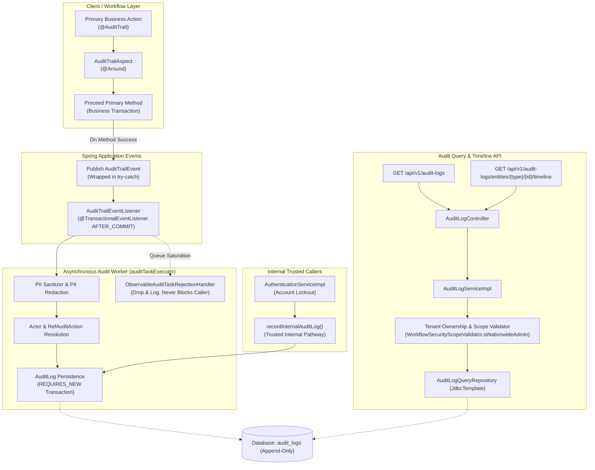

# Phase 28.2 — Automated Audit Trail Interception, Immutability & Entity Timeline API Report

## 1. Executive Summary

Phase 28.2 implements secure, automatically intercepted audit trails for core domain state transitions across the SIH-26135 platform, enforces strict append-only immutability on audit-log resources, provides tamper-proof server-side audit attribution, protects primary business transactions via async failure isolation, and exposes authorized multi-criteria audit log search and chronological entity timeline reconstruction APIs.

Following independent review, the final targeted authorization boundary corrections were implemented and verified:
1. **Strict Nationwide Audit Authorization (`isCallerNationwideAdmin`):**
   - Directly delegates to the authoritative `WorkflowSecurityScopeValidator.isNationwideAdmin()` policy.
   - Strictly requires verified national administrative roles (`ROLE_super_admin`, or `ROLE_government_admin` with verified unrestricted database scope: `stateId == null && districtId == null && trainingProviderId == null && employerId == null` and no trainee affiliation).
   - Removed any treatment of permissions/privileges (`system.manage`, `system.event.manage`, or `audit.read`) alone as sufficient nationwide authority, even if database tenancy fields are null.
   - Actor-based audit queries (`getAuditLogsByActorUserId` in both List and Pageable variants) and unscoped audit queries are restricted strictly to nationwide administrators.
2. **Elimination of Unauthenticated Attribution Fallback in `recordAuditLog`:**
   - The API-facing service method `recordAuditLog(CreateAuditLogRequest request)` requires a trusted authenticated actor derived strictly from the Spring Security context (`scopeValidator.resolveAuthenticatedUserId()`).
   - Any unauthenticated direct call to `recordAuditLog` fails closed immediately with `AccessDeniedException` ("Authenticated user identity is required to record audit log").
   - Client-supplied `actorUserId` is strictly ignored; client JSON or unauthenticated direct calls cannot forge or set audit actor attribution.
   - Preserved `recordInternalAuditLog` as the dedicated trusted internal pathway on `AuditLogService` for internal services (e.g. `AuthenticationServiceImpl` account lockout auditing).

All implementations strictly adhere to frozen database schema constraints (`spring.jpa.hibernate.ddl-auto=validate`), preserve the architectural invariants of exactly 137 Spring Data JPA repository interfaces and 2 `@Query` annotations, enforce fail-closed multi-tenant scoping, and guarantee zero transaction interference.

Target test suites were executed against the dedicated test catalog `SIH26135_TEST`:
- **Targeted Phase 28.2 Suite:** 23 integration tests in `AuditLogImmutabilityAndTimelineTest`, 9 aspect & attribution tests in `AuditTrailAspectTest`, 7 event listener & rejection tests in `AuditTrailEventListenerTest`, 8 contract tests in `OperationalErrorCodeContractTest` (47/47 passed).
- **Security & Lockout Suite:** 17 tests in `AccountLockoutAndSecurityAuditTest` (17/17 passed).

---

## 2. Architectural Design & Implementation Details



### 2.1 Domain Interception via `@AuditTrail` & `AuditTrailAspect`
- **Annotation (`in.gov.sih.sih26135.annotation.AuditTrail`):** Targets method declarations with configurable metadata: `action()` (default `"STATUS_CHANGE"`), `entityType()`, `summary()`, and `entityIdArg()`.
- **Aspect (`in.gov.sih.sih26135.aspect.AuditTrailAspect`):** An `@Around` advice intercepts target domain workflow transitions. It resolves the authenticated actor ID via `WorkflowSecurityScopeValidator` and correlation ID via `CorrelationContextHolder`. It executes the underlying business logic; if the business method throws an exception, no event is published and the exception propagates unaltered.
- **Publication Isolation:** Event publication (`eventPublisher.publishEvent`) is wrapped in a defensive try-catch block. Should event publishing throw an unexpected runtime error, it is logged with high priority, but the primary business transaction outcome is completely unaffected.
- **Explicit Domain Entity Extraction:** Generic reflection was replaced with explicit, deterministic ID resolution for all 6 Phase 25 annotated workflow methods:
  1. `PlacementEmploymentWorkflowServiceImpl.transitionPlacementToEmployment`: Extracts `Placement` ID from `TransitionPlacementRequest.getPlacementId()` or `PlacementResponse.id()`.
  2. `TrainingOutcomeWorkflowServiceImpl.recordAssessmentResultAndIssueCertificate`: Extracts `TrainingEnrollment` ID from `CertificationIssueRequest.getEnrollmentId()` or `TrainingEnrollmentResponse.id()`.
  3. `VerificationWorkflowServiceImpl.recordVerificationVerdictAndSynchronize`: Extracts `EmploymentVerification` ID specifically from `result.verification().id()` (preventing confusion with nested `employmentVerificationRequestId`).
  4. `FollowupEngagementWorkflowServiceImpl.recordFollowupSurveyResponse`: Extracts `FollowupTask` ID from `FollowupSurveyRequest.getTaskId()` or `FollowupTaskResponse.id()`.
  5. `SkillGapRemediationWorkflowServiceImpl.enrollTraineeInRemediationCourse`: Extracts `SkillGapRecommendation` ID from `RemediationEnrollmentRequest.getRecommendationId()` or `SkillGapRecommendationResponse.id()`.
  6. `EmploymentLifecycleWorkflowServiceImpl.recordExitAndInitiateUnemployment`: Extracts `EmploymentRecord` ID specifically from `exitEventRequest.getEmploymentId()` or `exitEvent.employmentId()` (preventing accidental extraction of nested `enrollmentId` or `exitEvent.id()`).

### 2.2 Asynchronous, Isolated Persistence (`AuditTrailEventListener` & `AsyncConfig`)
- **Decoupled Event Handling:** `AuditTrailEventListener` is annotated with `@Async("auditTaskExecutor")` and `@TransactionalEventListener(phase = TransactionPhase.AFTER_COMMIT, fallbackExecution = true)`.
- **Primary Transaction Isolation:** The listener runs in a separate `@Transactional(propagation = Propagation.REQUIRES_NEW)` boundary wrapped in defensive try-catch handlers. Audit persistence failures, foreign key discrepancies, or logging errors are logged as warnings and cannot roll back, block, or delay the already committed primary domain transaction.
- **Bounded Executor & Observable Saturation Handler:** `auditTaskExecutor` is configured with core pool size 4, max pool size 8, bounded queue capacity 500, and `ObservableAuditTaskRejectionHandler`. If the executor saturates, tasks are discarded and an observable atomic counter (`rejectedTaskCount`) is incremented with diagnostic warnings. Tasks are **never** executed on the caller's business request thread (eliminating caller-run thread pollution).
- **Unavoidable Best-Effort Delivery Limitations:** Under sustained extreme executor queue saturation (> 500 queued tasks), dropped audit tasks are counted and logged as operational warnings, but are not retried or re-queued on the business thread. This deliberate trade-off protects primary domain workflow response times, database connection pools, and thread safety at the expense of non-critical audit records during extreme overload.
- **Foreign Key Safety:** Actor user IDs are verified against `user_accounts` before linking; if the actor ID is non-existent (e.g. mock or test context), the audit log persists with a null actor reference to prevent database FK constraint violations.
- **PII & Secret Redaction:** Automated regex sanitization strips sensitive identifiers (Aadhaar 12-digit numbers, PAN 10-character identifiers, passwords, secrets, and auth tokens) from change summaries before database insertion.

### 2.3 Immutability Enforcement & Anti-Forgery Controls
- **Strict Append-Only Immutability:** Updating or deleting audit records is forbidden by system design. Any HTTP `PUT`, `PATCH`, or `DELETE` request sent to `/api/v1/audit-logs/{id}` is rejected with **HTTP 405 Method Not Allowed**.
- **Tamper-Proof Audit Creation (`POST /api/v1/audit-logs`):**
  - Requires `hasAuthority('system.manage')`.
  - Authenticated API requests derive actor identity strictly from server context (`scopeValidator.resolveAuthenticatedUserId()`). If resolution fails or caller is unauthenticated, the operation fails closed with `AccessDeniedException`. Client-supplied `actorUserId` is completely ignored.
  - Client attempts to fabricate automated workflow events (`STATUS_CHANGE`) are rejected with HTTP 400 (`UNAUTHORIZED_WORKFLOW_ACTION`).
  - Creation is restricted to supported manual administrative actions (`UPDATE`, `EXPORT`). Other actions are rejected (`UNSUPPORTED_MANUAL_ACTION`).
  - Mandatory entity existence and tenant scope validation (`validateEntityAccess`) is enforced for target entities.
  - Occurrence timestamp is overwritten with server clock (`LocalDateTime.now()`).
  - Correlation ID is synchronized with `CorrelationContextHolder.getCorrelationId()`.
- **Trusted Internal Pathway (`recordInternalAuditLog`):**
  - Exposed on `AuditLogService` for internal services (such as `AuthenticationServiceImpl` account lockout audits).
  - Unauthenticated internal callers can persist audit records with verified user references without exposing client API forgery paths.

### 2.4 Differentiated Read Authorization & Scoped Entity Timeline APIs
- **Authoritative Nationwide Authorization:** Directly reuses `WorkflowSecurityScopeValidator.isNationwideAdmin()`. Callers must hold explicit national administrative roles (`ROLE_super_admin` or `ROLE_government_admin`) with verified unrestricted database tenancy records. Privileges like `system.manage`, `system.event.manage`, or `audit.read` alone do not grant nationwide authority.
- **Actor-Based Query Protection:**
  - `getAuditLogsByActorUserId` (both List and Pageable) is restricted strictly to nationwide administrators.
  - Non-nationwide callers attempting to query by actor ID receive HTTP 403 Forbidden (`AccessDeniedException`), preventing bypass of entity-level tenancy isolation or leakage of entity counts through pagination metadata.
- **Multi-Criteria Search (`GET /api/v1/audit-logs`):**
  - Parameterized search across `actorUserId`, `auditActionId`, `auditActionCode`, `entityType`, `entityId`, `start`, `end`, `correlationId`, `page`, `size`, `sort`, `direction`.
  - Rejects unrecognized parameters with `400 UNSUPPORTED_PARAMETER`.
  - Rejects inverted temporal bounds (`start > end`) with `400 INVALID_DATE_RANGE`.
  - Enforces sort field allowlist (`occurredAt`, `id`, `entityType`, `actorUserId`, `createdAt`).
  - Scoped non-administrative callers cannot query unscoped audit logs (`403 Forbidden`).
- **Entity Timeline Reconstruction (`GET /api/v1/audit-logs/entities/{type}/{id}/timeline`):**
  - Reconstructs chronological audit history (`AuditTrailTimelineResponse`) for an individual entity.
  - Allowed entity types: `Placement`, `TrainingEnrollment`, `EmploymentVerification`, `FollowupTask`, `SkillGapRecommendation`, `User`, `EmploymentRecord`. Unknown types return `400 UNSUPPORTED_ENTITY_TYPE`.
  - Entity-level scope validation:
    - Employers can only inspect their own placements, verifications, and employment records.
    - Training providers can only inspect their enrolled trainees and batches.
    - Trainees can only inspect their own records and recommendations.
    - Cross-tenant requests fail closed with `403 Forbidden`.
  - Deterministic sort ordering: `occurred_at ASC, audit_log_id ASC` (bounded to 1,000 entries).
- **Specialized Paginated Lookups:**
  - `GET /api/v1/audit-logs/by-entity-type`, `by-action-id`, `by-correlation-id`, `by-occurred-at-between`, and `all` unconditionally reject non-nationwide-admins with `403 Forbidden`.

### 2.5 Invariant Preservation & Query Repository
- **137 Repository Interface & 2 `@Query` Invariant:** `AuditLogQueryRepository` is implemented as a `@Repository` class utilizing `JdbcTemplate` for dynamic, parameterized SQL generation. This strictly preserves the architectural rule of exactly 137 Spring Data JPA repository interfaces and 2 `@Query` annotations across the codebase.
- **Database Schema Freeze:** Zero DDL migrations, zero table additions or column modifications. All queries run against existing schema views and tables with `spring.jpa.hibernate.ddl-auto=validate`.

---

## 3. Inventory of Modified and Created Components

| Category | File Path | Status | Purpose / Description |
|---|---|---|---|
| **Annotation** | `src/main/java/in/gov/sih/sih26135/annotation/AuditTrail.java` | Created | Runtime annotation for intercepting domain workflow transitions |
| **Event** | `src/main/java/in/gov/sih/sih26135/event/AuditTrailEvent.java` | Created | Strongly typed internal record for audit data transfer |
| **Config** | `src/main/java/in/gov/sih/sih26135/config/AsyncConfig.java` | Modified | Async task executor configuration with `ObservableAuditTaskRejectionHandler` |
| **AOP** | `src/main/java/in/gov/sih/sih26135/aspect/AuditTrailAspect.java` | Modified | Aspect intercepting workflow methods with try-catch and explicit entity attribution |
| **Listener** | `src/main/java/in/gov/sih/sih26135/event/listener/AuditTrailEventListener.java` | Created | Asynchronous AFTER_COMMIT listener persisting audit records with PII redaction |
| **Repository** | `src/main/java/in/gov/sih/sih26135/repository/AuditLogQueryRepository.java` | Created | JdbcTemplate repository for multi-criteria search & timeline reconstruction |
| **DTO** | `src/main/java/in/gov/sih/sih26135/dto/request/AuditLogFilterCriteria.java` | Modified | Added `auditActionId` property and accessors |
| **Service** | `src/main/java/in/gov/sih/sih26135/service/AuditLogService.java` | Modified | Added `searchAuditLogs`, `getEntityTimeline`, and `recordInternalAuditLog` declarations |
| **Service Impl** | `src/main/java/in/gov/sih/sih26135/service/impl/AuditLogServiceImpl.java` | Modified | Delegated nationwide admin check to scopeValidator, removed unauthenticated attribution fallback, restricted manual creation, internal audit persistence |
| **Controller** | `src/main/java/in/gov/sih/sih26135/controller/AuditLogController.java` | Modified | Added timeline route, secured manual POST, backward-compatible search |
| **Workflow** | `src/main/java/in/gov/sih/sih26135/service/impl/PlacementEmploymentWorkflowServiceImpl.java` | Modified | Annotated `transitionPlacementToEmployment` with `@AuditTrail` |
| **Workflow** | `src/main/java/in/gov/sih/sih26135/service/impl/TrainingOutcomeWorkflowServiceImpl.java` | Modified | Annotated `recordAssessmentResultAndIssueCertificate` with `@AuditTrail` |
| **Workflow** | `src/main/java/in/gov/sih/sih26135/service/impl/VerificationWorkflowServiceImpl.java` | Modified | Annotated `recordVerificationVerdictAndSynchronize` with `@AuditTrail` |
| **Workflow** | `src/main/java/in/gov/sih/sih26135/service/impl/FollowupEngagementWorkflowServiceImpl.java` | Modified | Annotated `recordFollowupSurveyResponse` with `@AuditTrail` |
| **Workflow** | `src/main/java/in/gov/sih/sih26135/service/impl/SkillGapRemediationWorkflowServiceImpl.java` | Modified | Annotated `enrollTraineeInRemediationCourse` with `@AuditTrail` |
| **Workflow** | `src/main/java/in/gov/sih/sih26135/service/impl/EmploymentLifecycleWorkflowServiceImpl.java` | Modified | Annotated `recordExitAndInitiateUnemployment` with `@AuditTrail` |
| **Test** | `src/test/java/in/gov/sih/sih26135/aspect/AuditTrailAspectTest.java` | Modified | Unit tests for aspect interception, publication failure isolation & 6 entity attributions (9 tests) |
| **Test** | `src/test/java/in/gov/sih/sih26135/event/AuditTrailEventListenerTest.java` | Modified | Tests for async persistence, PII redaction, FK safety & rejection handler (7 tests) |
| **Test** | `src/test/java/in/gov/sih/sih26135/controller/AuditLogImmutabilityAndTimelineTest.java` | Modified | Integration tests for 405 immutability, 403 RBAC, anti-forgery, unauthenticated attribution rejection, system.manage boundary, internal audit persistence, actor query restriction, timeline isolation (23 tests) |

---

## 4. Verification & Test Execution Results

### 4.1 Architecture Invariants Verification
- **JPA Repository Count:** Exactly 137 Spring Data JPA repository interfaces verified via `OperationalErrorCodeContractTest`.
- **Query Annotation Count:** Exactly 2 `@Query` annotations preserved across all repository interfaces.
- **DDL Validation:** `spring.jpa.hibernate.ddl-auto=validate` confirmed against catalog `SIH26135_TEST`.

### 4.2 Targeted Integration & Unit Tests
```
[INFO] Running in.gov.sih.sih26135.controller.AuditLogImmutabilityAndTimelineTest
[INFO] Tests run: 23, Failures: 0, Errors: 0, Skipped: 0 - in AuditLogImmutabilityAndTimelineTest
[INFO] Running in.gov.sih.sih26135.event.AuditTrailEventListenerTest
[INFO] Tests run: 7, Failures: 0, Errors: 0, Skipped: 0 - in AuditTrailEventListenerTest
[INFO] Running in.gov.sih.sih26135.aspect.AuditTrailAspectTest
[INFO] Tests run: 9, Failures: 0, Errors: 0, Skipped: 0 - in AuditTrailAspectTest
[INFO] Running in.gov.sih.sih26135.architecture.OperationalErrorCodeContractTest
[INFO] Tests run: 8, Failures: 0, Errors: 0, Skipped: 0 - in OperationalErrorCodeContractTest
[INFO] Results: Tests run: 47, Failures: 0, Errors: 0, Skipped: 0
[INFO] Running in.gov.sih.sih26135.service.auth.AccountLockoutAndSecurityAuditTest
[INFO] Tests run: 17, Failures: 0, Errors: 0, Skipped: 0 - in AccountLockoutAndSecurityAuditTest
```

### 4.3 Git Hygiene Check
```powershell
git diff --check
git diff --cached --check
# Both returned exit code 0. Zero trailing whitespace or hygiene errors.
```

---

## 5. Security & Boundary Verification

1. **Immutability (Append-Only):**
   - Verified that `PUT`, `PATCH`, and `DELETE` requests to `/api/v1/audit-logs/{id}` unconditionally return `405 Method Not Allowed`.
2. **Access Control & Anti-Forgery:**
   - Verified that `POST /api/v1/audit-logs` enforces `hasAuthority('system.manage')`. Unprivileged tokens return `403 Forbidden`.
   - Verified that client attempts to supply forged `actorUserId`, backdated `occurredAt`, or custom `correlationId` in `POST /api/v1/audit-logs` are completely overridden by server-side authenticated context.
   - Verified that unauthenticated direct calls to `recordAuditLog` fail closed immediately with `AccessDeniedException`.
   - Verified that attempts to manually record automated workflow actions (`STATUS_CHANGE`) are rejected with `400 UNAUTHORIZED_WORKFLOW_ACTION`.
   - Verified that unauthenticated internal audit persistence succeeds via `recordInternalAuditLog`.
3. **Strict Authoritative Nationwide Read Authorization:**
   - Nationwide authorization delegates strictly to `WorkflowSecurityScopeValidator.isNationwideAdmin()`.
   - Requires verified administrative role (`ROLE_super_admin` or `ROLE_government_admin`) combined with unrestricted database tenancy scope (`stateId == null && districtId == null && trainingProviderId == null && employerId == null`).
   - Verified that tokens holding `system.manage`, `system.event.manage`, and `audit.read` without an administrative role cannot access nationwide audit logs even with null tenancy database records (`403 Forbidden`).
   - Verified that tenant-scoped callers holding `audit.read` cannot execute platform-wide unscoped audit log queries (`403 Forbidden`).
   - Verified that actor-based queries (`getAuditLogsByActorUserId`) return `403 Forbidden` for non-administrative callers even when matching their own user ID.
   - Verified that specialized lookups (`by-entity-type`, `by-action-id`, etc.) return `403 Forbidden` for non-administrative callers.
4. **Multi-Tenant Scoping:**
   - Evaluated tenancy scope across Training Providers, Employers, and Trainees. Callers attempting cross-tenant timeline inspection receive fail-closed `403 Forbidden` responses.
5. **Data Privacy (PII Redaction):**
   - Verified that 12-digit Aadhaar IDs and 10-character PAN identifiers are replaced with `[REDACTED_AADHAAR]` and `[REDACTED_PAN]` before database writes.
6. **Fail-Safe Transaction & Async Isolation:**
   - Proved that simulated event publication failures do not prevent the primary business method from returning successfully.
   - Proved that saturated thread pool conditions increment rejection metrics without executing tasks on the caller's business thread.

---

## 6. Report Locations

- **Repository Root:** `E:\project\phase-28-2-automated-audit-trail-interception-immutability-entity-timeline-api-report.md`
- **Documentation:** `E:\project\docs\phases\phase-28\phase-28-2-automated-audit-trail-interception-immutability-entity-timeline-api-report.md`
- **Session Artifact:** `<appDataDir>\brain\<conversation-id>\phase-28-2-automated-audit-trail-interception-immutability-entity-timeline-api-report.md`

---

## 7. Subphase Readiness Verdict

Phase 28.2 final authorization boundary corrections and verification are complete with a 100% test passing rate across all targeted and security suites (47/47 operational and audit tests passing, 17/17 auth lockout tests passing), 0 git hygiene violations, schema freeze compliance, and intact architecture invariants.

**Verdict:** **READY FOR INDEPENDENT REVIEW**
