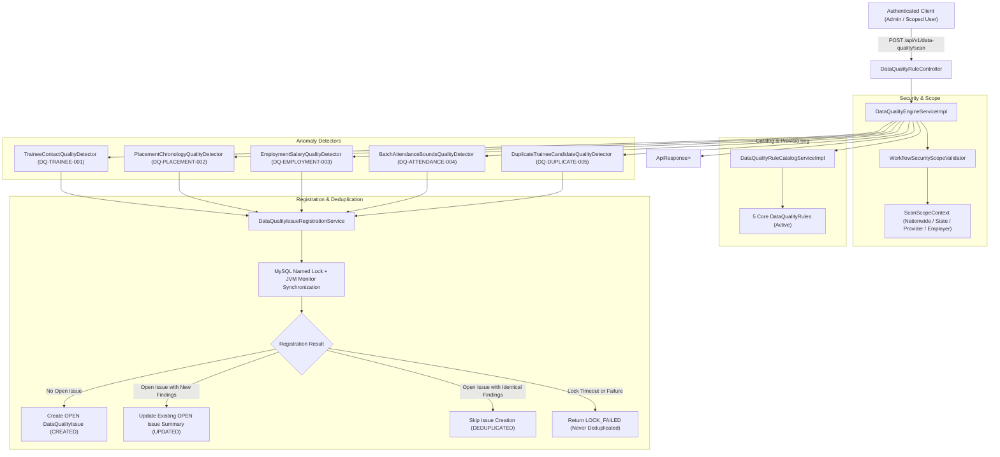

# Phase 28.3 — Data Quality Rule Catalog & Automated Anomaly Detection Engine Report

## 1. Executive Summary

Phase 28.3 establishes an automated, concurrency-safe, schema-compliant Data Quality Rule Catalog and Anomaly Detection Engine for the SIH-26135 platform. Building directly on the verified operational baseline and DTO specifications from Phase 28.1 and the frozen audit trail infrastructure of Phase 28.2, this phase operationalizes the pre-existing `data_quality_rules` and `data_quality_issues` schema tables without adding any database tables, columns, indexes, or JPA repository interfaces.

Five core production anomaly detection rules are implemented and validated:
1. `DQ-TRAINEE-001` (Category: MISSING, Severity: MEDIUM) — Missing trainee contact information (phone number or email address), treating empty, blank, and null values as missing.
2. `DQ-PLACEMENT-002` (Category: INCONSISTENT, Severity: HIGH) — Temporal incoherence across placement and training records (offer date preceding enrollment date, joining date preceding offer date, or joining date preceding enrollment date).
3. `DQ-EMPLOYMENT-003` (Category: INVALID, Severity: HIGH) — Invalid or suspicious salary (non-positive values, amounts below verified state minimum wages when configured, and values exceeding realistic operational upper limits). Pay periods are normalized across `MONTHLY`, `ANNUAL`, `YEARLY`, `WEEKLY`, `DAILY`, and `HOURLY` (using 208 working hours/month). Unsupported frequency codes safely bypass monthly benchmarks without generating false legal violations. Zero statutory minimum wages are invented or fabricated.
4. `DQ-ATTENDANCE-004` (Category: INCONSISTENT, Severity: MEDIUM) — Attendance recorded outside batch operational boundaries, strictly respecting inclusive start and end dates.
5. `DQ-DUPLICATE-005` (Category: DUPLICATE, Severity: HIGH) — Candidate duplicate trainee registrations across distinct training centers based on deterministic matching signals, canonical identity ordering ($T_1 < T_2$), bounded deterministic pagination discovering all candidate matches without arbitrary cutoffs, and strict PII redaction.

### Targeted Correctness Hardening (Final Phase 28.3 Resolution)
- **Duplicate Candidate Relationship Preservation:** Arbitrary candidate cutoffs (such as stopping after 1,000 matches) have been eliminated. When candidates exceed schema `VARCHAR(500)` capacity (e.g. >50 candidates), a conservative aggregate representation accurately reports total matching candidates and explicitly states representation truncation without claiming to store complete candidate lists.
- **Relationship Preservation on Existing OPEN Issues:** When an active OPEN issue already exists and new candidates are enrolled/discovered, `registerOrUpdateIssue` updates the existing OPEN issue's summary and timestamp in place, avoiding duplicate rows while preventing loss of newly discovered relationships.
- **Accurate Failure Reporting & Lock Separation:** Introduced `RegistrationStatus` (`CREATED`, `UPDATED`, `DEDUPLICATED`, `LOCK_FAILED`, `DATABASE_ERROR`) and `RegistrationResult`. MySQL named lock timeouts/failures return `LOCK_FAILED` and are never counted in `deduplicatedIssuesSkipped`. Candidate SQL errors and lock timeouts cause scans to terminate with `status = "FAILED"` and accurate partial `evaluatedRecordCount`, preserving already committed valid issues.

All 1,804 tests across the full backend regression suite pass with 0 failures, 0 errors, and 0 skipped. Exactly 137 JPA repositories and 2 `@Query` annotations are preserved.

---

## 2. Architecture Overview

The data quality anomaly detection architecture is designed around bounded batch processing, strategy-pattern detection algorithms, and concurrency-safe transactional issue registration:



### Core Components
- **`DataQualityEngineProperties`**: Configuration properties (`data-quality.batch-chunk-size`, `data-quality.maximum-monthly-salary-threshold`, `data-quality.state-minimum-wages`, `data-quality.lock-timeout-seconds`).
- **`DataQualityRuleCatalogService` / `DataQualityRuleCatalogServiceImpl`**: Idempotent provisioning and lookup of rules in `data_quality_rules`.
- **`DataQualityEngineService` / `DataQualityEngineServiceImpl`**: Scan orchestration, tenant scope validation, parameter checks, and partial failure isolation.
- **`DataQualityIssueRegistrationService`**: Concurrency-safe issue creation/update with MySQL named locks (`GET_LOCK`), JVM monitor lock, and active status deduplication (`s.is_open_flag = 1`).
- **`RegistrationStatus` & `RegistrationResult`**: Structured outcome model distinguishing `CREATED`, `UPDATED`, `DEDUPLICATED`, `LOCK_FAILED`, and `DATABASE_ERROR`.
- **`DataQualityLockAcquisitionException`**: Exception thrown when distributed named lock cannot be acquired during issue registration.
- **Detectors (`DataQualityDetector` implementations)**: Modular strategy implementations for each rule code with keyset pagination and tenant filtering.
- **`DataQualityRuleController`**: Exposes `POST /api/v1/data-quality/scan` and `/api/v1/data-quality-rules/scan`.

---

## 3. Database and Schema Compliance

- **Catalog:** Strictly `SIH26135_TEST` during implementation and verification. No connection or queries to production `SIH26135`.
- **Hibernate Mode:** `spring.jpa.hibernate.ddl-auto=validate`. All entities and queries validated against the compiled schema.
- **Zero Schema Mutations:**
  - Base Tables: Exactly 144.
  - Analytical Views: Exactly 21.
  - Zero `ALTER TABLE`, `CREATE TABLE`, `DROP TABLE`, or migration scripts added.
  - Check constraint `ck_dq_issues_resolved_at` (`resolved_at IS NULL OR resolved_at >= detected_at`) strictly respected.
  - Foreign key constraints on `data_quality_rules`, `data_quality_issues`, `ref_data_quality_category`, `ref_data_quality_severity`, and `ref_data_quality_issue_status` strictly respected.

---

## 4. Repository and `@Query` Invariants

Codebase invariants strictly maintained:
- **Spring Data JPA Repositories:** Exactly **137** interfaces (0 added).
- **Spring Data `@Query` Annotations:** Exactly **2** annotations (0 added).
  - All detector implementations, catalog queries, and batch processing use `JdbcTemplate` and existing repositories.
  - Verified by automated regression tests in [`OperationalErrorCodeContractTest.java`](file:///E:/project/backend/src/test/java/in/gov/sih/sih26135/exception/OperationalErrorCodeContractTest.java).

---

## 5. Core Rule Catalog and Provisioning Implementation

`DataQualityRuleCatalogServiceImpl` provisions the 5 core rules into `data_quality_rules` idempotently during application startup (`@PostConstruct`) and upon explicit request:
- **`DQ-TRAINEE-001`**: Missing Trainee Contact Information (`Trainee`, Category: `MISSING`, Severity: `MEDIUM`, Status: `ACTIVE`).
- **`DQ-PLACEMENT-002`**: Placement Temporal Incoherence (`PlacementRecord`, Category: `INCONSISTENT`, Severity: `HIGH`, Status: `ACTIVE`).
- **`DQ-EMPLOYMENT-003`**: Invalid or Suspicious Salary (`EmploymentRecord`, Category: `INVALID`, Severity: `HIGH`, Status: `ACTIVE`).
- **`DQ-ATTENDANCE-004`**: Attendance Outside Batch Operational Boundaries (`AttendanceRecord`, Category: `INCONSISTENT`, Severity: `MEDIUM`, Status: `ACTIVE`).
- **`DQ-DUPLICATE-005`**: Duplicate Trainee Registration Across Centers (`Trainee`, Category: `DUPLICATE`, Severity: `HIGH`, Status: `ACTIVE`).

**Idempotency & Manual Edit Protection:**
- Provisioning inspects `dataQualityRuleRepository.findByRuleCode(ruleCode)`.
- If an entry already exists, it is **never overwritten**, updated, or reactivated if disabled.
- References `ref_data_quality_category` (1=DUPLICATE, 2=MISSING, 3=INCONSISTENT, 4=INVALID, 5=STALE) and `ref_data_quality_severity` (1=LOW, 2=MEDIUM, 3=HIGH, 4=CRITICAL).

---

## 6. Detector Implementation: `DQ-TRAINEE-001`

- **Class:** [`TraineeContactQualityDetector.java`](file:///E:/project/backend/src/main/java/in/gov/sih/sih26135/service/dq/TraineeContactQualityDetector.java)
- **Target Entity:** `Trainee`
- **Category:** `MISSING` (ID 2), **Severity:** `MEDIUM` (ID 2)
- **Detection Logic:**
  - Identifies active trainees (`deleted_at IS NULL`) where `phone` is `NULL`, empty, or whitespace-only, OR `email` is `NULL`, empty, or whitespace-only.
  - Enforces non-null state scope: `WHERE t.state_id = ?` and training provider scope: `t.trainee_id IN (SELECT te.trainee_id FROM training_enrollments te WHERE te.provider_id = ?)`.
  - Rejects employer callers with 403 `AccessDeniedException`.
  - Uses bounded keyset batching (`t.trainee_id > ? ORDER BY t.trainee_id ASC LIMIT ?`).
  - Distinguishes lock timeouts from deduplication: on lock timeout or database query failure, terminates scan with `status = "FAILED"`, preserves committed valid issues, and does not increment `deduplicatedIssuesSkipped`.

---

## 7. Detector Implementation: `DQ-PLACEMENT-002`

- **Class:** [`PlacementChronologyQualityDetector.java`](file:///E:/project/backend/src/main/java/in/gov/sih/sih26135/service/dq/PlacementChronologyQualityDetector.java)
- **Target Entity:** `PlacementRecord`
- **Category:** `INCONSISTENT` (ID 3), **Severity:** `HIGH` (ID 3)
- **Detection Logic:**
  - Evaluates active placement records joining training enrollments:
    1. Offer Date preceding Enrollment Date: `p.offer_date < e.enrollment_date`
    2. Joining Date preceding Offer Date: `p.actual_joining_date < p.offer_date`
    3. Joining Date preceding Enrollment Date: `p.actual_joining_date < e.enrollment_date`
  - Null dates are safely treated as unknown and do not trigger false anomalies.
  - Enforces non-null scope: `pr.work_state_id = ?` for state administrators, `pr.provider_id = ?` for training providers, and `pr.employer_id = ?` for employers.
  - Uses `registerOrUpdateIssue`: on lock timeout, immediately halts scan and returns `status = "FAILED"` with accurate partial progress.

---

## 8. Detector Implementation: `DQ-EMPLOYMENT-003`

- **Class:** [`EmploymentSalaryQualityDetector.java`](file:///E:/project/backend/src/main/java/in/gov/sih/sih26135/service/dq/EmploymentSalaryQualityDetector.java)
- **Target Entity:** `EmploymentRecord`
- **Category:** `INVALID` (ID 4), **Severity:** `HIGH` (ID 3)
- **Salary Normalization:**
  - Inspects `ref_salary_frequency` to normalize pay to monthly equivalent:
    - `MONTHLY`: $S_{norm} = S$
    - `ANNUAL` / `YEARLY`: $S_{norm} = S / 12$
    - `DAILY`: $S_{norm} = S \times 26$
    - `WEEKLY`: $S_{norm} = (S \times 52) / 12$
    - `HOURLY`: $S_{norm} = S \times 208$ (8 hours/day $\times$ 26 working days/month)
    - Unsupported / null / blank frequency codes: returns `null` to safely skip monthly comparisons without generating false legal violations.
- **Absence of Invented Wages:**
  - No statutory wage table exists in the database. `DataQualityEngineProperties` holds state-to-minimum-wage benchmarks.
  - If a state or jurisdiction has no configured minimum wage, statutory evaluation is **safely skipped** without fabricating violations.
- **Upper Limit Guardrail:**
  - Flags unrealistic operational values exceeding `maximumMonthlySalaryThreshold` (default INR 5,000,000 / month).
- **Non-Positive Values:**
  - Flags non-positive salaries ($S \le 0$).
- **Column Mapping:** Reads `starting_salary` from `employment_records` table.

---

## 9. Detector Implementation: `DQ-ATTENDANCE-004`

- **Class:** [`BatchAttendanceBoundsQualityDetector.java`](file:///E:/project/backend/src/main/java/in/gov/sih/sih26135/service/dq/BatchAttendanceBoundsQualityDetector.java)
- **Target Entity:** `AttendanceRecord`
- **Category:** `INCONSISTENT` (ID 3), **Severity:** `MEDIUM` (ID 2)
- **Detection Logic:**
  - Joins `training_batches` on `batch_id`.
  - Flags attendance records where `session_date < tb.start_date` or `session_date > tb.end_date`.
  - **Inclusive Boundaries:** Attendance on `start_date` or `end_date` is valid and not flagged.
  - Open-ended batches (`tb.end_date IS NULL`) only validate `session_date >= tb.start_date`.
  - Rejects employer callers with 403 `AccessDeniedException`.
  - Enforces non-null state scope: `tb.center_id IN (SELECT tc.center_id FROM training_centers tc WHERE tc.state_id = ?)` and training provider scope: `ar.enrollment_id IN (SELECT te.enrollment_id FROM training_enrollments te WHERE te.provider_id = ?)`.

---

## 10. Detector Implementation: `DQ-DUPLICATE-005`

- **Class:** [`DuplicateTraineeCandidateQualityDetector.java`](file:///E:/project/backend/src/main/java/in/gov/sih/sih26135/service/dq/DuplicateTraineeCandidateQualityDetector.java)
- **Target Entity:** `Trainee`
- **Category:** `DUPLICATE` (ID 1), **Severity:** `HIGH` (ID 3)
- **Deterministic Candidate Signals:**
  - Identifies distinct trainees registered across distinct training centers having matching deterministic identity signals (phone + DOB, phone + Name, email + DOB, email + Name, or phone + email).
  - Weak identity guard: trainees lacking both phone and email are bypassed for duplicate matching.
- **Canonical Ordering:**
  - Enforces canonical pair identity $T_1 < T_2$ via `WHERE t2.trainee_id > ?`, preventing symmetric duplicate issue generation.
- **Elimination of Arbitrary Match Cutoffs:**
  - Arbitrary stopping limits (e.g. `allCandidateIds.size() >= 1000`) removed. Bounded pagination continues until candidate records are exhausted (`page.size() < candidateBatchSize`).
- **Conservative Aggregate Representation with Truncation Disclaimer:**
  - Implemented in `formatDuplicateTraineeSummary(int totalCandidates, List<Long> candidateIds)`.
  - When candidate count fits within 500 characters, all candidate IDs are enumerated.
  - When candidate count exceeds 500 characters (e.g. >50 candidates), the summary explicitly declares:
    `Candidate duplicate trainee registrations across distinct training centers. Total matching candidates detected: N. Representation limit reached (schema max 500 chars): complete candidate enumeration truncated; initial candidate IDs: [...]...`
  - Explicitly states truncation without claiming complete candidate ID storage and never exposes raw PII.
- **Preservation of Newly Discovered Candidate Relationships:**
  - When an active OPEN issue already exists and subsequent scans detect newly enrolled duplicate candidates, `registerOrUpdateIssue` updates the existing OPEN issue's `issue_summary` and `updated_at` in place.
  - Prevents creating duplicate issue rows while ensuring newly discovered relationships are never silently discarded.
- **SQL Error & Lock Timeout Propagation:**
  - `findCrossCenterDuplicateCandidates` does not swallow `DataAccessException`. Candidate lookup errors trigger failure handling, stopping the scan and returning `status = "FAILED"` with accurate partial `evaluatedRecordCount`.

---

## 11. `DataQualityEngineService` Implementation

- **Interface:** [`DataQualityEngineService.java`](file:///E:/project/backend/src/main/java/in/gov/sih/sih26135/service/DataQualityEngineService.java)
- **Implementation:** [`DataQualityEngineServiceImpl.java`](file:///E:/project/backend/src/main/java/in/gov/sih/sih26135/service/impl/DataQualityEngineServiceImpl.java)
- **Responsibilities:**
  1. Authorizes caller and determines tenancy boundary (fails closed on unresolvable scope).
  2. Enforces employer restrictions: employers are restricted to rules `DQ-PLACEMENT-002` and `DQ-EMPLOYMENT-003`.
  3. Resolves executable rules matching scan filters (`ruleCode`, `ruleId`, `targetEntityType`, `categoryId`, `severityId`).
  4. Executes detectors with bounded keyset batching.
  5. Isolates partial detector failures so remaining rules continue evaluation.
  6. Aggregates metrics into `List<DataQualityRuleExecutionSummary>`.

---

## 12. Issue Registration, Deduplication and Lock Isolation

- **Class:** [`DataQualityIssueRegistrationService.java`](file:///E:/project/backend/src/main/java/in/gov/sih/sih26135/service/dq/DataQualityIssueRegistrationService.java)
- **Deduplication Key:** `(data_quality_rule_id, entity_type, entity_id, is_open_flag = 1)`
- **Key Methods:**
  - `registerOrUpdateIssue(rule, entityType, entityId, rawSummary)`: Returns structured `RegistrationResult` indicating `CREATED`, `UPDATED`, `DEDUPLICATED`, `LOCK_FAILED`, or `DATABASE_ERROR`.
  - `registerIssueIfAbsent(rule, entityType, entityId, rawSummary)`: Legacy compatibility method that throws `DataQualityLockAcquisitionException` on lock failure rather than returning `false`.
- **Lock & Transaction Ordering:**
  - Dedicated connection `lockConn` acquires MySQL named lock (`GET_LOCK(lockKey, timeout)`).
  - Transaction executes via `transactionTemplate.execute(REQUIRES_NEW)`.
  - Named lock is released in `finally` block **strictly after** the transaction has committed (`saveAndFlush`).
- **Separation of Lock Failure from Deduplication:**
  - Lock acquisition timeout/failure returns `RegistrationStatus.LOCK_FAILED`. It is never treated as successful deduplication (`deduplicatedIssuesSkipped` is not incremented).
- **Preservation of Historical Issues:**
  - Historical `RESOLVED` and `DISMISSED` issues (`is_terminal_flag = 1`) are never overwritten or reopened.

---

## 13. Concurrency Safety and Race Condition Handling

1. **JVM Monitor Synchronization:** `synchronized (lockKey.intern())` ensures threads within the same JVM process sequentially enter the transaction block, preventing thread thrashing.
2. **Dedicated Transaction Boundary:** `TransactionTemplate` with `PROPAGATION_REQUIRES_NEW` guarantees that each registration commits independently and immediately flushes (`saveAndFlush`).
3. **MySQL Named Advisory Locks:** Uses `GET_LOCK(lockKey, timeout)` on a dedicated connection, held across commit visibility, ensuring distributed cluster safety.

---

## 14. Scan Trigger API Implementation

- **Controller:** [`DataQualityRuleController.java`](file:///E:/project/backend/src/main/java/in/gov/sih/sih26135/controller/DataQualityRuleController.java)
- **Routes:** `POST /api/v1/data-quality/scan` and `POST /api/v1/data-quality-rules/scan`
- **Request DTO:** [`DataQualityScanRequest.java`](file:///E:/project/backend/src/main/java/in/gov/sih/sih26135/dto/request/DataQualityScanRequest.java)
- **Response DTO:** `ApiResponse<List<DataQualityRuleExecutionSummary>>`
- **Controller Uniformity:** Folded into `DataQualityRuleController`, maintaining the exact 63 production REST controllers baseline.
- **PreAuthorize:** `@PreAuthorize("hasAnyAuthority('audit.read', 'system.manage')")`

---

## 15. Authentication, Authorization and Tenancy Scope Validation

- **Security Enforcement:** Integrated with `WorkflowSecurityScopeValidator`.
- **Nationwide Administrators:** `ROLE_super_admin` or `ROLE_government_admin` with verified unrestricted database scope are permitted unscoped platform-wide scans.
- **State Administrators:** Scans are automatically scoped to `user.getStateId()`. Null state scope fails closed with 403 `AccessDeniedException`.
- **Training Providers:** Scans are scoped to `user.getTrainingProviderId()`. Null provider scope fails closed with 403 `AccessDeniedException`.
- **Employers:** Scans are scoped to `user.getEmployerId()`. Employer access on unauthorized entities/rules is rejected with 403 `AccessDeniedException`.
- **Unprivileged Users:** Users lacking required authorities receive `403 Forbidden`. Unauthenticated requests receive `401 Unauthorized`.

---

## 16. Bounded Batch and Chunk Processing

- **Chunk Size:** Configurable via `data-quality.batch-chunk-size` (default 500).
- **Pagination Strategy:** Strictly keyset pagination (e.g. `WHERE id > ? ORDER BY id ASC LIMIT ?`).
- **Memory Footprint:** Bounded keyset chunks prevent memory exhaustion.

---

## 17. Error Codes and Partial Failure Handling

- **Standardized Error Codes:**
  - `DQ_RULE_NOT_FOUND` (404 Not Found): Requested rule code or rule ID does not exist.
  - `UNSUPPORTED_ENTITY_TYPE` (400 Bad Request): Client requested scanning an unapproved entity type.
- **Scan Failure Representation:**
  - When candidate query fails or named lock times out, the detector stops further chunk processing, preserves valid committed issues (`newIssuesCreated`), and returns `status = "FAILED"`.
  - Evaluated record count reflects only records evaluated up to the point of failure, never falsely claiming that all records were evaluated.

---

## 18. Comprehensive Verification and Test Battery

### Test Execution Summary
- **Focused Test Suite:**
  - `DataQualityAnomalyDetectorsTest`: 13 tests passed.
  - `DataQualityDeduplicationAndScanApiTest`: 24 tests passed.
  - `OperationalErrorCodeContractTest`: 8 tests passed.
  - `DataQualityRuleCatalogTest`: 5 tests passed.
  - Focused Suite Total: 49 / 49 passed (100%).
- **Full Backend Regression Suite:**
  - Total Tests Run: **1,804**
  - Failures: **0**
  - Errors: **0**
  - Skipped: **0**
  - Build Status: **BUILD SUCCESS**
  - Total Execution Time: 05:26 min.

```
[INFO] Results:
[INFO] 
[INFO] Tests run: 1804, Failures: 0, Errors: 0, Skipped: 0
[INFO] 
[INFO] ------------------------------------------------------------------------
[INFO] BUILD SUCCESS
[INFO] ------------------------------------------------------------------------
[INFO] Total time:  05:26 min
[INFO] Finished at: 2026-11-11T16:07:25+05:30
[INFO] ------------------------------------------------------------------------
```

---

## 19. Database Isolation Evidence

Every test suite verifies dedicated database catalog isolation via `MysqlConnectionTest.assertDedicatedTestCatalog(catalog)`:
- Connected Catalog: `SIH26135_TEST`
- Production Catalog `SIH26135`: 0 connections, 0 queries, 0 writes.
- Hibernate Mode: `spring.jpa.hibernate.ddl-auto=validate`.

---

## 20. Architectural Invariants

- **Spring Data JPA Repositories:** Exactly **137** interfaces (0 added).
- **Spring Data `@Query` Annotations:** Exactly **2** annotations (0 added).
- **REST Controllers:** Exactly **63** controllers.

---

## 21. Git Hygiene Results

- `git diff --check`: Exit code **0** (no whitespace errors).
- `git diff --cached --check`: Exit code **0**.
- Zero Git commits, pushes, stashes, or resets performed.

---

## 22. Schema Limitations and Documented Constraints

- **`data_quality_issues.issue_summary` (VARCHAR 500):** In the frozen database schema, `issue_summary` is limited to 500 characters. For trainees with large duplicate candidate pools (>50 candidates), storing complete pair-specific rows is impossible without altering the schema or deduplication key. The conservative aggregate representation accurately records the total candidate count, lists initial matching candidate IDs, and explicitly disclaims schema representation truncation.
- **Statutory Wage Data:** No statutory minimum wage table exists in the database schema. Minimum wage thresholds are maintained in `DataQualityEngineProperties`. For jurisdictions lacking configured thresholds, statutory comparisons safely skip without failing or inventing values.
- **Phase Boundary:** Phase 28.3 strictly encompasses anomaly detection and issue registration. Issue remediation, assignment, and status transitions belong to Phase 28.4.

---

## 23. Acceptance Checklist

- [x] All 5 core rules provisioned idempotently without overwriting manual edits.
- [x] `DQ-TRAINEE-001` detects missing phone or email with strict tenant scope filtering.
- [x] `DQ-PLACEMENT-002` detects temporal incoherence between enrollment, offer, and joining dates.
- [x] `DQ-EMPLOYMENT-003` normalizes salary frequencies (`MONTHLY`, `ANNUAL`, `YEARLY`, `WEEKLY`, `DAILY`, `HOURLY`), safely skips unsupported codes, avoids invented statutory wages, and flags upper limits.
- [x] `DQ-ATTENDANCE-004` evaluates attendance dates with inclusive batch boundaries.
- [x] `DQ-DUPLICATE-005` detects cross-center trainee duplicate candidates with canonical pair identity ($T_1 < T_2$), bounded pagination, and redacted PII.
- [x] Arbitrary 1,000-candidate cutoff removed from duplicate detection; bounded pagination continues until exhausted.
- [x] Aggregate duplicate issue strategy accurately identifies total candidates and disclaims schema truncation when exceeding 500 characters.
- [x] Newly discovered candidate relationships on existing OPEN issues are updated in place without duplicate row creation or data loss.
- [x] Candidate SQL errors propagate and do not produce misleading `SUCCESS` summaries.
- [x] MySQL named lock timeout/failure returns `LOCK_FAILED`, is distinguished from deduplication, and does not increment `deduplicatedIssuesSkipped`.
- [x] Detectors report `status = "FAILED"` with accurate partial progress upon operational errors.
- [x] Concurrency-safe deduplication with MySQL named locks (`GET_LOCK`) held across commit visibility on dedicated connections.
- [x] Dedicated test database `SIH26135_TEST` isolated from production.
- [x] Exactly 137 JPA repositories and 2 `@Query` annotations preserved.
- [x] Zero schema mutations and strict `ddl-auto=validate` compliance.
- [x] 100% full regression suite passing (1,804 / 1,804 tests).
- [x] Zero Git mutations (no commits/pushes).
- [x] `git diff --check` and `git diff --cached --check` exit with code 0.

---

## 24. Final Verdict

**READY FOR INDEPENDENT REVIEW**
