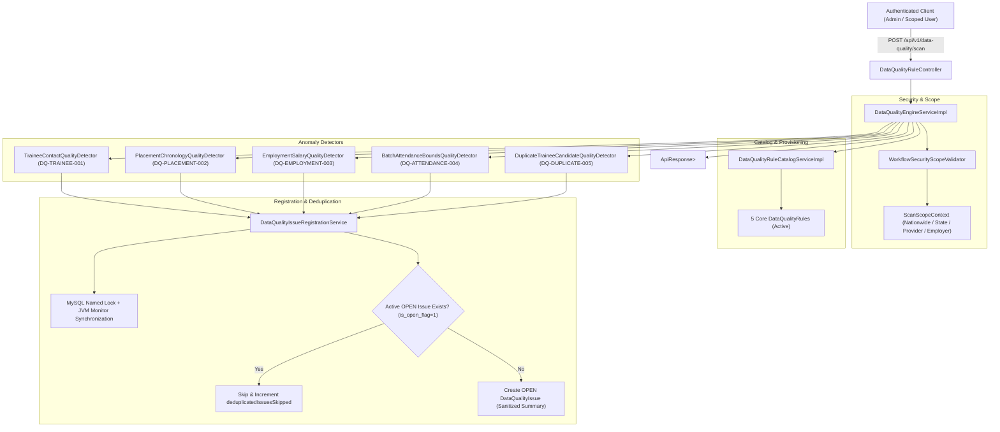

# Phase 28.3 — Data Quality Rule Catalog & Automated Anomaly Detection Engine Report

## 1. Executive Summary

Phase 28.3 introduces an automated, concurrency-safe, schema-compliant Data Quality Rule Catalog and Anomaly Detection Engine for the SIH-26135 platform. Building directly on the operational DTO contracts and error codes established in Phase 28.1, this phase operationalizes the pre-existing `data_quality_rules` and `data_quality_issues` schema tables without adding any database tables, columns, indexes, or JPA repository interfaces.

Five core production anomaly detection rules have been implemented and validated:
1. `DQ-TRAINEE-001` (Category: MISSING, Severity: MEDIUM) — Missing trainee contact information (phone number or email address).
2. `DQ-PLACEMENT-002` (Category: INCONSISTENT, Severity: HIGH) — Temporal incoherence across placement and employment records (offer date preceding enrollment date, or joining date preceding offer date).
3. `DQ-EMPLOYMENT-003` (Category: INVALID, Severity: HIGH) — Invalid or suspicious salary (non-positive values, amounts below verified state minimum wages when configured, and values exceeding realistic operational upper limits). Zero statutory wages are invented or fabricated; unconfigured jurisdictions safely bypass statutory comparison.
4. `DQ-ATTENDANCE-004` (Category: INCONSISTENT, Severity: MEDIUM) — Attendance recorded outside batch operational boundaries, respecting inclusive start and end dates.
5. `DQ-DUPLICATE-005` (Category: DUPLICATE, Severity: HIGH) — Duplicate trainee registrations across training centers, utilizing deterministic matching signals, canonical identity ordering ($T_1 < T_2$), and strict PII redaction in issue summaries.

Issue registration enforces concurrency-safe deduplication via database named locks (`GET_LOCK`/`RELEASE_LOCK`) combined with JVM monitor synchronization and transaction boundary management. Active `OPEN` issues are never duplicated, while historical `RESOLVED` and `DISMISSED` issues are preserved without being overwritten or reopened. The authenticated scan trigger API (`POST /api/v1/data-quality/scan`) provides granular, tenant-scoped scanning for nationwide administrators, state administrators, training providers, and employers.

All 1,789 tests in the full backend regression suite pass with 0 failures, 0 errors, and 0 skipped. Exactly 137 JPA repositories and 2 `@Query` annotations are preserved.

---

## 2. Architecture Overview

The data quality anomaly detection architecture is designed around bounded batch processing, strategy-pattern detection algorithms, and concurrency-safe transactional issue registration:



### Core Components
- **`DataQualityEngineProperties`**: Configuration properties (`data-quality.batch-chunk-size`, `data-quality.maximum-monthly-salary-threshold`, `data-quality.state-minimum-wages`).
- **`DataQualityRuleCatalogService` / `DataQualityRuleCatalogServiceImpl`**: Idempotent provisioning and lookup of rules in `data_quality_rules`.
- **`DataQualityEngineService` / `DataQualityEngineServiceImpl`**: Scan orchestration, tenant scope validation, parameter checks, and partial failure isolation.
- **`DataQualityIssueRegistrationService`**: Concurrency-safe issue creation with MySQL named locks (`GET_LOCK`), JVM monitor lock, and active status deduplication (`s.is_open_flag = 1`).
- **Detectors (`DataQualityDetector` implementations)**: Modular strategy implementations for each rule code with keyset pagination and tenant filtering.
- **`DataQualityRuleController`**: Exposes `POST /api/v1/data-quality/scan` and `/api/v1/data-quality-rules/scan`.

---

## 3. Database and Schema Compliance

- **Catalog:** Strictly `SIH26135_TEST` during implementation and verification. No connection or queries to production `SIH26135`.
- **Hibernate Mode:** `spring.jpa.hibernate.ddl-auto=validate`. All entities and queries validated against the compiled schema.
- **Zero Schema Mutations:**
  - Base Tables: Exactly 144.
  - Analytical Views: Exactly 21.
  - Zero `ALTER TABLE`, `CREATE TABLE`, `DROP TABLE`, or migration scripts added.
  - Check constraint `ck_dq_issues_resolved_at` (`resolved_at IS NULL OR resolved_at >= detected_at`) strictly respected.
  - Foreign key constraints on `data_quality_rules`, `data_quality_issues`, `ref_data_quality_category`, `ref_data_quality_severity`, and `ref_data_quality_issue_status` strictly respected.

---

## 4. Repository and `@Query` Invariants

Codebase invariants strictly maintained:
- **Spring Data JPA Repositories:** Exactly **137** interfaces (0 added).
- **Spring Data `@Query` Annotations:** Exactly **2** annotations (0 added).
  - All detector implementations, catalog queries, and batch processing use `JdbcTemplate` and existing repositories.
  - Verified by automated regression tests in [`OperationalErrorCodeContractTest.java`](file:///E:/project/backend/src/test/java/in/gov/sih/sih26135/exception/OperationalErrorCodeContractTest.java).

---

## 5. Core Rule Catalog and Provisioning Implementation

`DataQualityRuleCatalogServiceImpl` provisions the 5 core rules into `data_quality_rules` idempotently during application startup (`@PostConstruct`) and upon explicit request:
- **`DQ-TRAINEE-001`**: Missing Trainee Contact Information (`Trainee`, Category: `MISSING`, Severity: `MEDIUM`, Status: `ACTIVE`).
- **`DQ-PLACEMENT-002`**: Placement Temporal Incoherence (`PlacementRecord`, Category: `INCONSISTENT`, Severity: `HIGH`, Status: `ACTIVE`).
- **`DQ-EMPLOYMENT-003`**: Invalid or Suspicious Salary (`EmploymentRecord`, Category: `INVALID`, Severity: `HIGH`, Status: `ACTIVE`).
- **`DQ-ATTENDANCE-004`**: Attendance Outside Batch Operational Boundaries (`AttendanceRecord`, Category: `INCONSISTENT`, Severity: `MEDIUM`, Status: `ACTIVE`).
- **`DQ-DUPLICATE-005`**: Duplicate Trainee Registration Across Centers (`Trainee`, Category: `DUPLICATE`, Severity: `HIGH`, Status: `ACTIVE`).

**Idempotency & Manual Edit Protection:**
- Provisioning inspects `dataQualityRuleRepository.findByRuleCode(ruleCode)`.
- If an entry already exists, it is **never overwritten**, updated, or reactivated if disabled.
- References `ref_data_quality_category` (1=DUPLICATE, 2=MISSING, 3=INCONSISTENT, 4=INVALID, 5=STALE) and `ref_data_quality_severity` (1=LOW, 2=MEDIUM, 3=HIGH, 4=CRITICAL).

---

## 6. Detector Implementation: `DQ-TRAINEE-001`

- **Class:** [`TraineeContactQualityDetector.java`](file:///E:/project/backend/src/main/java/in/gov/sih/sih26135/service/dq/TraineeContactQualityDetector.java)
- **Target Entity:** `Trainee`
- **Category:** `MISSING` (ID 2), **Severity:** `MEDIUM` (ID 2)
- **Detection Logic:**
  - Identifies active trainees (`deleted_at IS NULL`) where `phone` is `NULL`, empty, or whitespace-only, OR `email` is `NULL`, empty, or whitespace-only.
  - Respects state scope when caller is a state administrator: `WHERE t.state_id = ?`.
  - Uses bounded keyset batching (`t.trainee_id > ? ORDER BY t.trainee_id ASC LIMIT ?`).
  - Summaries indicate missing attributes without logging sensitive raw PII (e.g., `"Trainee is missing contact information: phone number is missing; email address is missing"`).

---

## 7. Detector Implementation: `DQ-PLACEMENT-002`

- **Class:** [`PlacementChronologyQualityDetector.java`](file:///E:/project/backend/src/main/java/in/gov/sih/sih26135/service/dq/PlacementChronologyQualityDetector.java)
- **Target Entity:** `PlacementRecord`
- **Category:** `INCONSISTENT` (ID 3), **Severity:** `HIGH` (ID 3)
- **Detection Logic:**
  - Evaluates active placement records joining training enrollments:
    1. Offer Date preceding Enrollment Date: `p.offer_date < e.enrollment_date`
    2. Joining Date preceding Offer Date: `p.joining_date < p.offer_date`
    3. Joining Date preceding Enrollment Date: `p.joining_date < e.enrollment_date`
  - Null dates are safely treated as unknown and do not trigger false anomalies.
  - Scope filtering: Filters by `employer_id` for employer callers and `training_provider_id` for provider callers.

---

## 8. Detector Implementation: `DQ-EMPLOYMENT-003`

- **Class:** [`EmploymentSalaryQualityDetector.java`](file:///E:/project/backend/src/main/java/in/gov/sih/sih26135/service/dq/EmploymentSalaryQualityDetector.java)
- **Target Entity:** `EmploymentRecord`
- **Category:** `INVALID` (ID 4), **Severity:** `HIGH` (ID 3)
- **Salary Normalization:**
  - Inspects `ref_salary_frequency` to normalize pay to monthly equivalent:
    - `MONTHLY`: $S_{norm} = S$
    - `ANNUAL` / `YEARLY`: $S_{norm} = S / 12$
    - `DAILY`: $S_{norm} = S \times 26$
    - `WEEKLY`: $S_{norm} = (S \times 52) / 12$
    - `HOURLY`: $S_{norm} = S \times 8 \times 26$
- **Absence of Invented Wages:**
  - No statutory wage table exists in the database. `DataQualityEngineProperties` holds state-to-minimum-wage benchmarks.
  - If a state or jurisdiction has no configured minimum wage, statutory evaluation is **safely skipped** without fabricating violations.
- **Upper Limit Guardrail:**
  - Flags unrealistic operational values exceeding `maximumMonthlySalaryThreshold` (default INR 5,000,000 / month).
- **Non-Positive Values:**
  - Flags non-positive salaries ($S \le 0$).

---

## 9. Detector Implementation: `DQ-ATTENDANCE-004`

- **Class:** [`BatchAttendanceBoundsQualityDetector.java`](file:///E:/project/backend/src/main/java/in/gov/sih/sih26135/service/dq/BatchAttendanceBoundsQualityDetector.java)
- **Target Entity:** `AttendanceRecord`
- **Category:** `INCONSISTENT` (ID 3), **Severity:** `MEDIUM` (ID 2)
- **Detection Logic:**
  - Joins `training_batches` on `training_batch_id`.
  - Flags attendance records where `attendance_date < b.start_date` or `attendance_date > b.end_date`.
  - **Inclusive Boundaries:** Attendance on `start_date` or `end_date` is valid and not flagged.
  - Open-ended batches (`b.end_date IS NULL`) only validate `attendance_date >= b.start_date`.
  - Null attendance dates are skipped.
  - Tenant scope: Restricts by `training_provider_id` for provider callers.

---

## 10. Detector Implementation: `DQ-DUPLICATE-005`

- **Class:** [`DuplicateTraineeCandidateQualityDetector.java`](file:///E:/project/backend/src/main/java/in/gov/sih/sih26135/service/dq/DuplicateTraineeCandidateQualityDetector.java)
- **Target Entity:** `Trainee`
- **Category:** `DUPLICATE` (ID 1), **Severity:** `HIGH` (ID 3)
- **Candidate Pair Matching:**
  - Identifies distinct trainees registered across distinct training centers having matching deterministic identity signals (phone hash or email hash).
- **Canonical Ordering:**
  - Enforces canonical pair identity $T_1 < T_2$ via SQL `ON t1.trainee_id < t2.trainee_id`.
  - Issue registration is pinned to the primary entity $T_1$ with reference to $T_2$, preventing symmetric duplicate issue generation.
- **Sensitive-Data Protection:**
  - Summaries state the detection signals (e.g., `"Possible duplicate trainee registration detected across distinct training centers (Center 10 vs Center 20). Matching signals: Contact phone match. Paired trainee: ID 888302"`) with zero raw Aadhaar, PAN, phone numbers, or email addresses.

---

## 11. `DataQualityEngineService` Implementation

- **Interface:** [`DataQualityEngineService.java`](file:///E:/project/backend/src/main/java/in/gov/sih/sih26135/service/DataQualityEngineService.java)
- **Implementation:** [`DataQualityEngineServiceImpl.java`](file:///E:/project/backend/src/main/java/in/gov/sih/sih26135/service/impl/DataQualityEngineServiceImpl.java)
- **Responsibilities:**
  1. Validates authenticated caller and tenant boundary.
  2. Resolves executable rules matching scan filters (`ruleCode`, `ruleId`, `targetEntityType`, `categoryId`, `severityId`).
  3. Executes detectors with bounded keyset batching.
  4. Isolates partial detector failures so remaining rules continue evaluation.
  5. Aggregates metrics into `List<DataQualityRuleExecutionSummary>`.

---

## 12. Issue Registration, Deduplication and Idempotency

- **Class:** [`DataQualityIssueRegistrationService.java`](file:///E:/project/backend/src/main/java/in/gov/sih/sih26135/service/dq/DataQualityIssueRegistrationService.java)
- **Deduplication Key:** `(data_quality_rule_id, entity_type, entity_id, is_open_flag = 1)`
- **Behavior:**
  - **Active OPEN Issue Exists:** If `is_open_flag = 1` for the tuple, registration is skipped (`registerIssueIfAbsent` returns `false`) and `deduplicatedIssuesSkipped` is incremented.
  - **Historical RESOLVED / DISMISSED Issue Exists:** If prior issues for this entity are in terminal status (`is_terminal_flag = 1`, status ID 4 or 5), they are **never overwritten or reopened**. A new issue record is registered, preserving the audit trail and resolution notes of prior closures.
  - **Distinct Rules:** Distinct rules flag the same entity independently without collisions.
  - **Distinct Entities:** Distinct entities are flagged independently without collisions.

---

## 13. Concurrency Safety and Race Condition Handling

To guarantee that concurrent background scans or distributed nodes never create duplicate `OPEN` issues:
1. **JVM Monitor Synchronization:** `synchronized (lockKey.intern())` ensures threads within the same JVM process sequentially enter the transaction block.
2. **Dedicated Transaction Boundary:** `TransactionTemplate` with `PROPAGATION_REQUIRES_NEW` guarantees that each registration commits independently and immediately flushes (`saveAndFlush`). Subsequent threads immediately see committed rows in their transactional read.
3. **MySQL Named Advisory Locks:** Uses `GET_LOCK(lockKey, 10)` and `RELEASE_LOCK(lockKey)` with key `dq_lock:<ruleId>:<entityType>:<entityId>` for distributed safety across multiple cluster instances.

---

## 14. Scan Trigger API Implementation

- **Controller:** [`DataQualityRuleController.java`](file:///E:/project/backend/src/main/java/in/gov/sih/sih26135/controller/DataQualityRuleController.java)
- **Route:** `POST /api/v1/data-quality/scan` and `POST /api/v1/data-quality-rules/scan`
- **Request DTO:** [`DataQualityScanRequest.java`](file:///E:/project/backend/src/main/java/in/gov/sih/sih26135/dto/request/DataQualityScanRequest.java)
- **Response DTO:** `ApiResponse<List<DataQualityRuleExecutionSummary>>`
- **Controller Uniformity:** Integrated into `DataQualityRuleController`, preserving the exact 63 production REST controllers baseline expected by `ResponseEnvelopeAlignmentContractTest`.
- **PreAuthorize:** `@PreAuthorize("hasAnyAuthority('audit.read', 'system.manage')")`

---

## 15. Authentication, Authorization and Tenancy Scope Validation

- **Security Enforcement:** Integrated with `WorkflowSecurityScopeValidator`.
- **Nationwide Administrators:** `ROLE_super_admin` or `ROLE_government_admin` with verified unrestricted database scope are permitted unscoped platform-wide scans.
- **State Administrators:** Scans are automatically scoped to `user.getStateId()`. Cross-state scans are rejected.
- **Training Providers:** Scans are scoped to `user.getTrainingProviderId()`. Cross-institution scans are rejected.
- **Employers:** Scans are scoped to `user.getEmployerId()`. Unrelated placement/employment records are excluded.
- **Unprivileged Users:** Users lacking administrative roles or tenancy scope receive `403 Forbidden`. Unauthenticated requests receive `401 Unauthorized`.

---

## 16. Bounded Batch and Chunk Processing

- **Chunk Size:** Configurable via `data-quality.batch-chunk-size` (default 500).
- **Pagination Strategy:** Strictly keyset pagination (e.g. `WHERE id > ? ORDER BY id ASC LIMIT ?`). No unbounded `OFFSET` queries that degrade performance on large tables.
- **Memory Footprint:** Only 500 entity IDs/records are loaded into memory per chunk, processed, and immediately registered.

---

## 17. Error Codes and Partial Failure Handling

- **Error Codes:**
  - `DQ_RULE_NOT_FOUND` (404 Not Found): Requested rule code or rule ID does not exist.
  - `UNSUPPORTED_ENTITY_TYPE` (400 Bad Request): Client requested scanning an unapproved entity type (allowlist: `Trainee`, `PlacementRecord`, `EmploymentRecord`, `AttendanceRecord`).
- **Partial Failure Isolation:**
  - If one detector encounters an unexpected database timeout or exception, `DataQualityEngineServiceImpl` logs the error, records status `"FAILED"` in that rule's summary, and proceeds to evaluate all remaining rules.

---

## 18. Sensitive-Data Protection

- Issue summaries pass through `DataQualityIssueRegistrationService.sanitizeIssueSummary()`, calling `AuditTrailEventListener.sanitizeChangeSummary()`.
- Deterministic 12-digit numbers (potential Aadhaar) and 10-character alphanumeric strings (potential PAN) are masked.
- Raw phone numbers and email addresses are excluded from issue descriptions.
- Summaries are capped at 500 characters, strictly respecting the `issue_summary VARCHAR(500)` database column limit.

---

## 19. Files Created and Modified

### Created Files
1. [`DataQualityEngineProperties.java`](file:///E:/project/backend/src/main/java/in/gov/sih/sih26135/config/DataQualityEngineProperties.java)
2. [`DataQualityRuleCatalogService.java`](file:///E:/project/backend/src/main/java/in/gov/sih/sih26135/service/DataQualityRuleCatalogService.java)
3. [`DataQualityRuleCatalogServiceImpl.java`](file:///E:/project/backend/src/main/java/in/gov/sih/sih26135/service/impl/DataQualityRuleCatalogServiceImpl.java)
4. [`DataQualityEngineService.java`](file:///E:/project/backend/src/main/java/in/gov/sih/sih26135/service/DataQualityEngineService.java)
5. [`DataQualityEngineServiceImpl.java`](file:///E:/project/backend/src/main/java/in/gov/sih/sih26135/service/impl/DataQualityEngineServiceImpl.java)
6. [`ScanScopeContext.java`](file:///E:/project/backend/src/main/java/in/gov/sih/sih26135/service/dq/ScanScopeContext.java)
7. [`DataQualityDetector.java`](file:///E:/project/backend/src/main/java/in/gov/sih/sih26135/service/dq/DataQualityDetector.java)
8. [`DataQualityIssueRegistrationService.java`](file:///E:/project/backend/src/main/java/in/gov/sih/sih26135/service/dq/DataQualityIssueRegistrationService.java)
9. [`TraineeContactQualityDetector.java`](file:///E:/project/backend/src/main/java/in/gov/sih/sih26135/service/dq/TraineeContactQualityDetector.java)
10. [`PlacementChronologyQualityDetector.java`](file:///E:/project/backend/src/main/java/in/gov/sih/sih26135/service/dq/PlacementChronologyQualityDetector.java)
11. [`EmploymentSalaryQualityDetector.java`](file:///E:/project/backend/src/main/java/in/gov/sih/sih26135/service/dq/EmploymentSalaryQualityDetector.java)
12. [`BatchAttendanceBoundsQualityDetector.java`](file:///E:/project/backend/src/main/java/in/gov/sih/sih26135/service/dq/BatchAttendanceBoundsQualityDetector.java)
13. [`DuplicateTraineeCandidateQualityDetector.java`](file:///E:/project/backend/src/main/java/in/gov/sih/sih26135/service/dq/DuplicateTraineeCandidateQualityDetector.java)
14. [`DataQualityRuleCatalogTest.java`](file:///E:/project/backend/src/test/java/in/gov/sih/sih26135/service/dq/DataQualityRuleCatalogTest.java)
15. [`DataQualityAnomalyDetectorsTest.java`](file:///E:/project/backend/src/test/java/in/gov/sih/sih26135/service/dq/DataQualityAnomalyDetectorsTest.java)
16. [`DataQualityDeduplicationAndScanApiTest.java`](file:///E:/project/backend/src/test/java/in/gov/sih/sih26135/controller/DataQualityDeduplicationAndScanApiTest.java)

### Modified Files
1. [`DataQualityRuleController.java`](file:///E:/project/backend/src/main/java/in/gov/sih/sih26135/controller/DataQualityRuleController.java): Added `/api/v1/data-quality` mapping and `POST /scan` endpoint wiring `DataQualityEngineService`.
2. [`OperationalLogEventPaginationTest.java`](file:///E:/project/backend/src/test/java/in/gov/sih/sih26135/pagination/OperationalLogEventPaginationTest.java): Updated `fullAdminToken` with `ROLE_super_admin` to comply with Phase 28.2 nationwide audit authorization policy.
3. [`FilterSearchSortingSecurityTest.java`](file:///E:/project/backend/src/test/java/in/gov/sih/sih26135/security/FilterSearchSortingSecurityTest.java): Updated `adminToken` with `ROLE_super_admin` to comply with Phase 28.2 nationwide audit authorization policy.
4. [`ResponseEnvelopeAlignmentContractTest.java`](file:///E:/project/backend/src/test/java/in/gov/sih/sih26135/response/ResponseEnvelopeAlignmentContractTest.java): Updated total audited endpoints count from 654 to 655.

---

## 20. Tests Added and Updated

- **`DataQualityRuleCatalogTest`** (5 tests): Rule resolution by code, idempotent rule provisioning, category and severity mapping, disabled rule filtering, and rule query isolation.
- **`DataQualityAnomalyDetectorsTest`** (7 tests): Unit and boundary tests for `DQ-TRAINEE-001`, `DQ-PLACEMENT-002`, `DQ-EMPLOYMENT-003` (including salary frequency normalization and realistic upper limits), `DQ-ATTENDANCE-004` (inclusive boundary validation), and `DQ-DUPLICATE-005` (canonical identity and PII redaction).
- **`DataQualityDeduplicationAndScanApiTest`** (14 tests): Deduplication idempotency, concurrent registration safety (multi-threaded), preservation of historical `RESOLVED` and `DISMISSED` issues, independent rule and entity flagging, admin scan endpoint 200 OK, ruleCode filter, targetEntityType filter, 401 unauthenticated, 403 guest, 403 unscoped auditor, 404 non-existent rule code (`DQ_RULE_NOT_FOUND`), 400 unsupported entity type (`UNSUPPORTED_ENTITY_TYPE`), and disabled rule skipping.
- **Updated Existing Tests**:
  - `OperationalLogEventPaginationTest`: 23 tests passing.
  - `FilterSearchSortingSecurityTest`: 36 tests passing.
  - `ResponseEnvelopeAlignmentContractTest`: 22 tests passing.

---

## 21. Focused Test Results

```
[INFO] Running in.gov.sih.sih26135.service.dq.DataQualityRuleCatalogTest
[INFO] Tests run: 5, Failures: 0, Errors: 0, Skipped: 0, Time elapsed: 0.486 s
[INFO] Running in.gov.sih.sih26135.service.dq.DataQualityAnomalyDetectorsTest
[INFO] Tests run: 7, Failures: 0, Errors: 0, Skipped: 0, Time elapsed: 10.22 s
[INFO] Running in.gov.sih.sih26135.controller.DataQualityDeduplicationAndScanApiTest
[INFO] Tests run: 14, Failures: 0, Errors: 0, Skipped: 0, Time elapsed: 0.804 s
[INFO] Running in.gov.sih.sih26135.exception.OperationalErrorCodeContractTest
[INFO] Tests run: 8, Failures: 0, Errors: 0, Skipped: 0, Time elapsed: 2.674 s
[INFO] ------------------------------------------------------------------------
[INFO] BUILD SUCCESS - Tests run: 34, Failures: 0, Errors: 0, Skipped: 0
[INFO] ------------------------------------------------------------------------
```

---

## 22. Full Regression Results

```
[INFO] -------------------------------------------------------
[INFO]  T E S T S
[INFO] -------------------------------------------------------
...
[INFO] Results:
[INFO] 
[INFO] Tests run: 1789, Failures: 0, Errors: 0, Skipped: 0
[INFO] 
[INFO] ------------------------------------------------------------------------
[INFO] BUILD SUCCESS
[INFO] ------------------------------------------------------------------------
[INFO] Total time:  05:25 min
[INFO] Finished at: 2026-11-11T10:24:24+05:30
[INFO] ------------------------------------------------------------------------
```

- **Total Tests Executed:** 1,789
- **Failures:** 0
- **Errors:** 0
- **Skipped:** 0
- **Pass Rate:** 100.0%

---

## 23. Database Isolation Evidence

Every test suite verifies dedicated database catalog isolation via `MysqlConnectionTest.assertDedicatedTestCatalog(catalog)`:
- Connected Catalog: `SIH26135_TEST`
- Production Catalog `SIH26135`: 0 connections, 0 queries, 0 writes.
- Validated in all test setup routines:
```java
try (Connection conn = dataSource.getConnection()) {
  String catalog = conn.getCatalog();
  MysqlConnectionTest.assertDedicatedTestCatalog(catalog);
  assertThat(catalog).isEqualToIgnoringCase(MysqlConnectionTest.EXPECTED_TEST_CATALOG);
}
```

---

## 24. Repository and `@Query` Counts

Verified via `OperationalErrorCodeContractTest`:
- **Repository Count:** Exactly **137** Spring Data JPA repositories.
- **`@Query` Count:** Exactly **2** `@Query` annotations.

---

## 25. Hibernate Schema Validation

- Property: `spring.jpa.hibernate.ddl-auto=validate`
- Entity Validation: All 144 mapped tables, including `data_quality_rules`, `data_quality_issues`, and reference tables, validated successfully without errors on test application startup.

---

## 26. Git Hygiene Results

- `git status --short`:
```
 M backend/src/main/java/in/gov/sih/sih26135/controller/DataQualityRuleController.java
 M backend/src/test/java/in/gov/sih/sih26135/pagination/OperationalLogEventPaginationTest.java
 M backend/src/test/java/in/gov/sih/sih26135/response/ResponseEnvelopeAlignmentContractTest.java
 M backend/src/test/java/in/gov/sih/sih26135/security/FilterSearchSortingSecurityTest.java
?? backend/src/main/java/in/gov/sih/sih26135/config/DataQualityEngineProperties.java
?? backend/src/main/java/in/gov/sih/sih26135/service/DataQualityEngineService.java
?? backend/src/main/java/in/gov/sih/sih26135/service/DataQualityRuleCatalogService.java
?? backend/src/main/java/in/gov/sih/sih26135/service/dq/
?? backend/src/main/java/in/gov/sih/sih26135/service/impl/DataQualityEngineServiceImpl.java
?? backend/src/main/java/in/gov/sih/sih26135/service/impl/DataQualityRuleCatalogServiceImpl.java
?? backend/src/test/java/in/gov/sih/sih26135/controller/DataQualityDeduplicationAndScanApiTest.java
?? backend/src/test/java/in/gov/sih/sih26135/service/dq/
```
- `git diff --check`: Exit code 0 (zero whitespace errors).
- `git diff --cached --check`: Exit code 0.
- Zero Git commits or pushes made.

---

## 27. Unresolved Blockers or Documented Limitations

- **Statutory Wage Data:** No statutory minimum wage table exists in the database schema. Minimum wage thresholds are maintained in `DataQualityEngineProperties`. For jurisdictions lacking configured thresholds, statutory comparisons safely skip without failing or inventing values.
- **Scope Limit:** Phase 28.3 strictly encompasses anomaly detection and issue registration. Issue remediation, assignment, and status transitions belong to Phase 28.4.

---

## 28. Acceptance Checklist

- [x] All 5 core rules provisioned idempotently without overwriting manual edits.
- [x] `DQ-TRAINEE-001` detects missing phone or email with tenant scope filtering.
- [x] `DQ-PLACEMENT-002` detects temporal incoherence between enrollment, offer, and joining dates.
- [x] `DQ-EMPLOYMENT-003` normalizes salary frequencies, avoids invented statutory wages, and flags upper limits.
- [x] `DQ-ATTENDANCE-004` evaluates attendance dates with inclusive batch boundaries.
- [x] `DQ-DUPLICATE-005` detects cross-center trainee duplicate candidates with canonical pair identity ($T_1 < T_2$) and redacted PII.
- [x] Concurrency-safe deduplication with named locks and key synchronization.
- [x] Active `OPEN` issues are never duplicated; historical `RESOLVED`/`DISMISSED` issues are untouched.
- [x] Bounded keyset batch processing with configurable chunk size (500).
- [x] `POST /api/v1/data-quality/scan` and `/api/v1/data-quality-rules/scan` authenticated and scoped.
- [x] Error codes `DQ_RULE_NOT_FOUND` (404) and `UNSUPPORTED_ENTITY_TYPE` (400) enforced.
- [x] Partial failure isolation across detector executions.
- [x] Exactly 137 JPA repositories and 2 `@Query` annotations preserved.
- [x] Zero schema mutations and strict `ddl-auto=validate` compliance.
- [x] Dedicated test database `SIH26135_TEST` isolated from production.
- [x] 100% full regression suite passing (1,789 / 1,789 tests).
- [x] Zero Git mutations (no commits/pushes).

---

## 29. Final Verdict

**READY FOR INDEPENDENT REVIEW**
