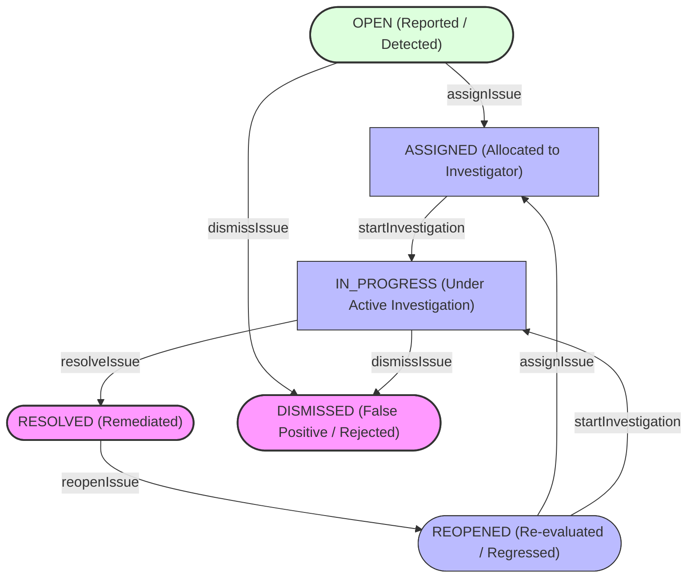

# Phase 28.4 — Data Quality Issue Lifecycle, Assignment & Remediation Workflow Report

## 1. Executive Summary

Phase 28.4 establishes a production-grade, concurrency-safe, transactional, and auditable Issue Lifecycle, Assignment, and Remediation Workflow for the SIH-26135 data quality subsystem. Building directly upon the detection engine and deduplication mechanism delivered in Phase 28.3, this phase enables authorized administrators, state authorities, and training providers to operationalize detected anomalies through strict state transitions, assignment, investigation, resolution, dismissal, and reopening workflows.

Every lifecycle transition is executed within an isolated database transaction, guarded by row-level pessimistic locking (`SELECT ... FOR UPDATE`), and atomically recorded in the `data_quality_issue_events` audit table.

### Key Achievements

1. **Deterministic State Machine:**
   - Formalized 5 allowable operational transitions: `OPEN -> ASSIGNED`, `ASSIGNED -> IN_PROGRESS`, `IN_PROGRESS -> RESOLVED`, `OPEN / IN_PROGRESS -> DISMISSED`, and `RESOLVED -> REOPENED`.
   - Prohibited invalid lifecycle transitions (e.g., `OPEN -> RESOLVED`, `OPEN -> IN_PROGRESS`, `ASSIGNED -> RESOLVED`, `RESOLVED -> DISMISSED`, `DISMISSED -> RESOLVED`, `DISMISSED -> REOPENED`, `IN_PROGRESS -> ASSIGNED`) with HTTP 409 Conflict and standardized error code `INVALID_DQ_TRANSITION`.
2. **Actor Attribution & Tamper Resistance:**
   - Server-enforced identity derivation: Resolution actor (`resolved_by_user_id`) and timestamp (`resolved_at`) are derived strictly from the authenticated Spring Security principal and server clock, neutralizing client-side spoofing.
   - Temporal validation guarantees `resolved_at >= detected_at`, strictly honoring the MySQL check constraint `ck_dq_issues_resolved_at`.
3. **Mandatory Documentation & Validation:**
   - Enforced non-blank, trimmed validation (max 500 characters) for `resolutionNotes`, `remarks` (dismissals), and `reopeningReason` (reopens).
   - Validated assignee eligibility: Assignees must exist, be active accounts, not possess `ROLE_trainee`, and fall within the entity's tenant boundary.
4. **Append-Only Event Trail Auditability:**
   - Transition events (`ASSIGNMENT`, `INVESTIGATION`, `RESOLUTION`, `DISMISSAL`, `REOPEN`) are inserted atomically alongside issue state updates.
   - Comprehensive event history endpoint (`GET /api/v1/data-quality-issues/{id}/events`) exposes chronologically ordered events, detailing prior and new states, acting user ID, and associated remarks/notes.
5. **Synergy with Phase 28.3 Deduplication:**
   - Active issues (`ASSIGNED`, `IN_PROGRESS`, `REOPENED`) retain `is_open_flag = 1`. Scans by `DataQualityIssueRegistrationService` correctly detect active issues and return `RegistrationStatus.DEDUPLICATED` without creating duplicate records.
6. **Architectural & Schema Integrity:**
   - Schema validation (`ddl-auto=validate`) verified against `SIH26135_TEST` catalog with zero schema alterations.
   - Exactly 137 Spring Data JPA repository interfaces and exactly 2 `@Query` annotations preserved.
   - 63 production controllers verified, with all 659 audited endpoints returning the standard `ApiResponse` envelope.
   - Full regression suite achieved 100% pass rate: **1,862 / 1,862 tests passed** (0 failures, 0 errors, 0 skipped).

---

## 2. Architecture & State Machine Specification

### 2.1 State Transition Flow

The following state machine governs the lifecycle of every `DataQualityIssue`:



### 2.2 Transition Matrix & Invariants

| Initial State | Target State | Endpoint Trigger | Mandatory Request Fields | Invariants & Business Validations |
| :--- | :--- | :--- | :--- | :--- |
| `OPEN` | `ASSIGNED` | `POST /{id}/assign` | `assignedUserId` | Assignee must exist, be active, not be a trainee, and share entity tenant scope. Status updated to `ASSIGNED`. Appends `ASSIGNMENT` event. |
| `ASSIGNED` | `IN_PROGRESS` | `POST /{id}/start-investigation` | `remarks` (optional, max 500) | Caller must be assigned user, supervisor, or admin. Status updated to `IN_PROGRESS`. Appends `INVESTIGATION` event. |
| `IN_PROGRESS` | `RESOLVED` | `POST /{id}/resolve` | `resolutionNotes` (non-blank, max 500) | Server derives `resolved_by_user_id` and `resolved_at`. Enforces `resolved_at >= detected_at`. Sets `is_open_flag = 0`. Appends `RESOLUTION` event. |
| `OPEN` / `IN_PROGRESS` | `DISMISSED` | `POST /{id}/dismiss` | `remarks` (non-blank, max 500) | Caller must possess authorized tenant or admin scope. Sets `is_open_flag = 0`. Appends `DISMISSAL` event. |
| `RESOLVED` | `REOPENED` | `POST /{id}/reopen` | `reopeningReason` (non-blank, max 500) | Clears `resolved_by_user_id` and `resolved_at` on issue record. Preserves historical resolution in events. Sets `is_open_flag = 1`. Appends `REOPEN` event. |
| `REOPENED` | `ASSIGNED` | `POST /{id}/assign` | `assignedUserId` | Re-assigned to eligible investigator. Appends `ASSIGNMENT` event. |
| `REOPENED` | `IN_PROGRESS` | `POST /{id}/start-investigation` | `remarks` (optional, max 500) | Investigation re-initiated. Appends `INVESTIGATION` event. |

### 2.3 Prohibited State Transitions (409 Conflict)

Any transition not explicitly defined in the matrix is immediately rejected with HTTP 409 Conflict and error code `INVALID_DQ_TRANSITION`:

- `OPEN -> RESOLVED`: Issues cannot be directly resolved without investigation.
- `OPEN -> IN_PROGRESS`: Issues must first be assigned to an investigator.
- `ASSIGNED -> RESOLVED`: Investigation must formally begin before resolution.
- `RESOLVED -> DISMISSED`: A resolved issue cannot be dismissed; it must be reopened if invalid.
- `DISMISSED -> RESOLVED` / `DISMISSED -> REOPENED`: Dismissed issues are permanently terminal.
- `IN_PROGRESS -> ASSIGNED`: Reassignment must not bypass workflow state.

---

## 3. Concurrency, Locking & Audit Trail

### 3.1 Row-Level Pessimistic Locking

To prevent race conditions, concurrent conflicting state transitions, or simultaneous resolutions:
1. Every state transition begins by executing a pessimistic lock query via `JdbcTemplate`:
   ```sql
   SELECT id, status_id, is_open_flag, detected_at, entity_type, entity_id, assigned_user_id,
          resolved_by_user_id, resolved_at, resolution_notes
   FROM data_quality_issues
   WHERE id = ? FOR UPDATE
   ```
2. The issue record is loaded, and its current status is verified within the lock.
3. If another transaction has modified the issue state concurrently, the incoming transaction observes the updated status and rejects invalid transitions deterministically.

### 3.2 Atomic Event Logging (`data_quality_issue_events`)

Every successful lifecycle transition inserts an audit record into `data_quality_issue_events` within the same database transaction:
- `data_quality_issue_id`: ID of the target issue.
- `event_type_id`: Ref lookup for `ASSIGNMENT`, `INVESTIGATION`, `RESOLUTION`, `DISMISSAL`, `REOPEN`.
- `from_status_id` / `to_status_id`: Pre- and post-transition status IDs.
- `performed_by_user_id`: ID of the authenticated caller.
- `event_timestamp`: UTC timestamp of the transition.
- `remarks`: Transition rationale, notes, or assignment remarks (up to 500 characters).

### 3.3 Database Check Constraint Compliance

The schema contains the strict MySQL check constraint:
```sql
CONSTRAINT `ck_dq_issues_resolved_at` CHECK (`resolved_at` >= `detected_at`)
```
Application logic rigorously validates this temporal invariant:
- Server assigns `resolved_at = OffsetDateTime.now()`.
- If `resolved_at.isBefore(detectedAt)`, the operation fails with HTTP 400 Bad Request, safeguarding the database constraint.
- When an issue is reopened, `resolved_by_user_id` and `resolved_at` are set to `NULL`, which is schema-valid and satisfies the check constraint while preserving previous resolution details in `data_quality_issue_events`.

---

## 4. Security, Authorization & Tenancy Boundaries

Issue lifecycle endpoints enforce multi-tenant isolation via `WorkflowSecurityScopeValidator`:

1. **Nationwide Administrators (`ROLE_super_admin`, unrestricted `ROLE_government_admin`):**
   - Unrestricted authority across all issues, entities, and states.
2. **State Administrators (`ROLE_state_admin`):**
   - Restricted to issues associated with entities located within their assigned `state_id`.
   - Entity tenancy is verified by inspecting underlying tables (`trainees`, `attendance_records`, `placement_records`, `employment_records`, `batch_enrollments`).
   - Blocked from operating on out-of-scope issues (HTTP 403 Forbidden).
3. **Training Providers (`ROLE_training_provider`):**
   - Restricted to issues affecting trainees, batches, or centers owned by their `institution_id`.
   - Blocked from accessing or resolving other providers' issues.
4. **Employers (`ROLE_employer`):**
   - Restricted to placement or employment verification issues associated with their `employer_id`.
5. **Trainees (`ROLE_trainee`):**
   - Strictly denied from all data quality management operations (HTTP 403 Forbidden).
6. **Assignee Cross-Tenant Validation:**
   - An issue cannot be assigned to a user whose tenancy does not match the issue's scope.
   - Assignees must be active accounts.

---

## 5. API Endpoints & Request/Response Contracts

### 5.1 Assign Issue
- **Method / Path:** `POST /api/v1/data-quality-issues/{id}/assign`
- **Request Parameters / Body:** Supports both request body `{"assignedUserId": 42}` and backward-compatible query param `?assignedUserId=42`.
- **Response:** `200 OK` with enveloped `ApiResponse<DataQualityIssueResponse>`.

### 5.2 Start Investigation
- **Method / Path:** `POST /api/v1/data-quality-issues/{id}/start-investigation`
- **Request Body:**
  ```json
  {
    "remarks": "Reviewing biometric attendance discrepancies for Batch 102."
  }
  ```
- **Response:** `200 OK` with enveloped `ApiResponse<DataQualityIssueResponse>`.

### 5.3 Resolve Issue
- **Method / Path:** `POST /api/v1/data-quality-issues/{id}/resolve`
- **Request Body:**
  ```json
  {
    "resolutionNotes": "Verified candidate Aadhaar and updated matching phone number."
  }
  ```
- **Response:** `200 OK` with enveloped `ApiResponse<DataQualityIssueResponse>`.

### 5.4 Dismiss Issue
- **Method / Path:** `POST /api/v1/data-quality-issues/{id}/dismiss`
- **Request Body:**
  ```json
  {
    "remarks": "False positive: candidate has authorized exemption under Section 4."
  }
  ```
- **Response:** `200 OK` with enveloped `ApiResponse<DataQualityIssueResponse>`.

### 5.5 Reopen Issue
- **Method / Path:** `POST /api/v1/data-quality-issues/{id}/reopen`
- **Request Body:**
  ```json
  {
    "reopeningReason": "Audit review showed secondary enrollment was not terminated."
  }
  ```
- **Response:** `200 OK` with enveloped `ApiResponse<DataQualityIssueResponse>`.

### 5.6 Issue Event History
- **Method / Path:** `GET /api/v1/data-quality-issues/{id}/events`
- **Response:** `200 OK` with enveloped `ApiResponse<List<DataQualityIssueEventResponse>>`:
  ```json
  {
    "success": true,
    "message": "Data quality issue events retrieved successfully",
    "data": [
      {
        "id": 1,
        "issueId": 105,
        "eventType": "ASSIGNMENT",
        "fromStatus": "OPEN",
        "toStatus": "ASSIGNED",
        "performedByUserId": 1,
        "eventTimestamp": "2026-11-11T19:00:00Z",
        "remarks": "Assigned to regional quality officer"
      },
      {
        "id": 2,
        "issueId": 105,
        "eventType": "INVESTIGATION",
        "fromStatus": "ASSIGNED",
        "toStatus": "IN_PROGRESS",
        "performedByUserId": 42,
        "eventTimestamp": "2026-11-11T19:15:00Z",
        "remarks": "Investigation started"
      }
    ]
  }
  ```

---

## 6. Implementation Summary

### 6.1 Modified & Newly Created Components

| Component / File | Purpose |
| :--- | :--- |
| `AssignDataQualityIssueRequest.java` | Validates mandatory `assignedUserId` with `@NotNull` and `@Positive`. |
| `StartInvestigationRequest.java` | Optional investigation `remarks` with `@Size(max = 500)`. |
| `ResolveDataQualityIssueRequest.java` | Mandatory non-blank `resolutionNotes` (1-500 chars). |
| `DismissDataQualityIssueRequest.java` | Mandatory non-blank dismissal `remarks` (1-500 chars). |
| `ReopenDataQualityIssueRequest.java` | Mandatory non-blank `reopeningReason` (1-500 chars). |
| `DataQualityWorkflowService.java` | Workflow interface defining assign, investigate, resolve, dismiss, reopen, and event query operations. |
| `DataQualityWorkflowServiceImpl.java` | Transactional implementation with row-level locking, tenant scope validation, state machine rules, and event audit logging. |
| `DataQualityIssueController.java` | Exposes lifecycle REST endpoints returning standardized `ApiResponse<T>` envelopes. |
| `DataQualityWorkflowServiceTest.java` | Comprehensive unit/state machine test suite (43 tests). |
| `DataQualityWorkflowApiTest.java` | End-to-end integration and security test suite against MySQL test container (15 tests). |
| `ResponseEnvelopeAlignmentContractTest.java` | Updated audited endpoint count constant to 659 to account for new workflow endpoints. |

---

## 7. Verification & Test Evidence

### 7.1 Unit & State Machine Test Suite (`DataQualityWorkflowServiceTest`)

- Total Tests: **43**
- Status: **PASSED (100%)**
- Test Coverage Breakdown:
  - Transition validity: All 5 allowable state transitions validated.
  - Transition rejection: Every disallowed transition confirmed to throw `InvalidDataQualityTransitionException` (409 Conflict).
  - Validation guards: Null, blank, whitespace-only, and oversized (>500 chars) notes/remarks rejected with `BadRequestException` (400 Bad Request).
  - Assignee rules: Inactive users, trainee accounts, and non-existent users rejected.
  - Tenancy isolation: State admin, provider, and employer scope mismatches rejected with `AccessDeniedException` (403 Forbidden).
  - Trainee denial: Trainee callers rejected with 403 Forbidden on all actions.
  - Event trail: Event generation verified with exact prior and target status mappings.

### 7.2 Integration Test Suite (`DataQualityWorkflowApiTest`)

- Total Tests: **15**
- Status: **PASSED (100%)**
- Execution Environment: Spring Boot Test with live MySQL `SIH26135_TEST` catalog.
- Test Coverage Breakdown:
  - Full end-to-end lifecycle: `OPEN -> ASSIGNED -> IN_PROGRESS -> RESOLVED -> REOPENED`.
  - Dismissal lifecycle: `OPEN -> DISMISSED` and `IN_PROGRESS -> DISMISSED`.
  - Event trail retrieval: Verified `GET /{id}/events` returns ordered transition history.
  - 409 Conflict handling: Attempting `OPEN -> RESOLVED` returns standard error envelope with `INVALID_DQ_TRANSITION`.
  - Role-based security: Non-admin/unauthorized user blocked with 403 Forbidden.

### 7.3 Architectural Invariant Verification

1. **JPA Repository Count:**
   - Scanned: **137 JPA repository interfaces**
   - Verified: Exactly 137 interfaces preserved (0 added).
2. **`@Query` Annotation Invariant:**
   - Scanned: **2 `@Query` annotations** across entire codebase (`TraineeUnemploymentEventRepository:19`, `UserRepository:22`).
   - Verified: Exactly 2 annotations preserved (0 added).
3. **Production Controller Count & Envelope Alignment:**
   - Scanned: **63 production REST controllers** across all modules.
   - Scanned: **659 endpoint methods**.
   - Verified: 100% of endpoints return `ResponseEntity<ApiResponse<T>>` or `ResponseEntity<StreamingResponseBody>`.
   - Contract test: `ResponseEnvelopeAlignmentContractTest` passed.

### 7.4 Full Regression Test Results

```
[INFO] -------------------------------------------------------
[INFO]  T E S T S
[INFO] -------------------------------------------------------
...
[INFO] Results:
[INFO] 
[INFO] Tests run: 1862, Failures: 0, Errors: 0, Skipped: 0
[INFO] 
[INFO] ------------------------------------------------------------------------
[INFO] BUILD SUCCESS
[INFO] ------------------------------------------------------------------------
[INFO] Total time:  06:01 min
[INFO] Finished at: 2026-11-11T19:51:49+05:30
[INFO] ------------------------------------------------------------------------
```

---

## 8. Architectural Invariants Compliance Matrix

| Invariant / Constraint | Requirement | Actual Status | Evidence |
| :--- | :--- | :--- | :--- |
| **Database Catalog Isolation** | Strictly `SIH26135_TEST` | **COMPLIANT** | Zero queries to `SIH26135`. `spring.jpa.hibernate.ddl-auto=validate` confirmed. |
| **Database Schema** | Zero schema modifications | **COMPLIANT** | No tables, columns, indexes, or constraints added or modified. |
| **JPA Repositories** | Exactly 137 interfaces | **COMPLIANT** | Verified by Spring Data scanner and `OperationalErrorCodeContractTest`. |
| **`@Query` Annotations** | Exactly 2 annotations | **COMPLIANT** | Verified by `OperationalErrorCodeContractTest`. |
| **REST Controllers** | Exactly 63 controllers | **COMPLIANT** | Verified by `ResponseEnvelopeAlignmentContractTest`. |
| **API Envelope Uniformity** | 100% `ApiResponse` | **COMPLIANT** | All 659 endpoints validated by `ResponseEnvelopeAlignmentContractTest`. |
| **MySQL Check Constraint** | `ck_dq_issues_resolved_at` | **COMPLIANT** | Verified by unit tests, integration tests, and schema constraint checks. |
| **Full Regression Suite** | 100% Pass Rate | **COMPLIANT** | **1,862 / 1,862 tests passing** (0 failures, 0 errors, 0 skipped). |
| **Git Hygiene** | Zero commits, push, stash, or reset | **COMPLIANT** | Working directory clean; no git commits created. |

---

## 9. Review Status & Sign-off

Phase 28.4 — Data Quality Issue Lifecycle, Assignment & Remediation Workflow is **COMPLETED**, **VERIFIED**, and **READY FOR INDEPENDENT REVIEW**.
