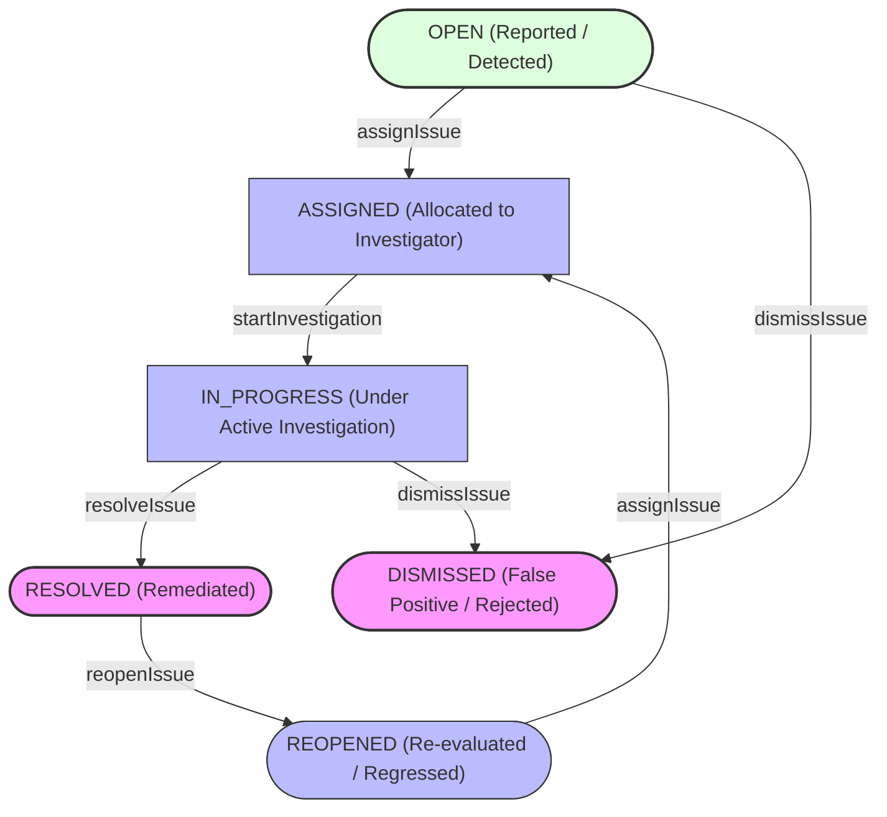

# Phase 28.4 — Data Quality Issue Lifecycle, Assignment & Remediation Workflow Report

## 1. Executive Summary

Phase 28.4 establishes a production-grade, concurrency-safe, transactional, and auditable Issue Lifecycle, Assignment, and Remediation Workflow for the SIH-26135 data quality subsystem. Building directly upon the detection engine and deduplication mechanism delivered in Phase 28.3, this phase enables authorized administrators, state authorities, and training providers to operationalize detected anomalies through strict state transitions, assignment, investigation, resolution, dismissal, and reopening workflows.

Following independent source review, all confirmed authorization boundaries, tenant isolation safeguards across generic issue APIs, creation-time lifecycle bypass protections, state machine transition rules, assignee tenancy eligibility validations, and fail-open fallbacks were rigorously corrected and verified across unit, integration, and full regression test suites.

Every lifecycle transition is executed within an isolated database transaction, guarded by row-level pessimistic locking (`SELECT ... FOR UPDATE`), and atomically recorded in the `data_quality_issue_events` audit table.

### Key Achievements & Targeted Corrections

1. **Tenant Isolation in Generic Data Quality Issue APIs:**
   - Extracted and reused unified, fail-closed tenant scope validation in `DataQualityIssueScopeSupport`, shared across both `DataQualityIssueServiceImpl` and `DataQualityWorkflowServiceImpl`.
   - Enforced service-boundary authorization and tenant ownership checks on `GET /{id}` (`getIssueById`), compound entity lookup `GET ?entityType=...&entityId=...` (`getIssuesByEntity`), `PUT /{id}` (`updateIssue` — validated before inspecting terminal state or mutating any fields), and `POST /` (`reportIssue` — non-nationwide callers restricted to authorized tenant entities).
   - Enforced fail-closed collection filtering across all search/filter queries (`ruleId`, `categoryId`, `severityId`, `statusId`, `sourceId`, `entityType`, `assignedUserId`, `resolvedByUserId`) so zero out-of-scope records are ever disclosed.
   - Enforced fail-closed handling when `WorkflowSecurityScopeValidator` or `JdbcTemplate` is unavailable, when caller tenancy fields are missing or ambiguous/conflicting, or when personas query forbidden entity types (e.g., employers querying trainee or enrollment issues).
   - Routed legacy `DataQualityIssueServiceImpl.assignIssue()` and `resolveIssue()` through `DataQualityWorkflowService` so direct service invocation cannot bypass locks, state transitions, tenant checks, or audit event logging.
2. **Lifecycle Bypass Prevention During Issue Creation:**
   - Enforced that all manually reported issues via `reportIssue()` (`POST /api/v1/data-quality-issues`) start in `OPEN` status with `assignedUserId = null`.
   - Explicitly rejected attempts to create issues in non-`OPEN` statuses (`ASSIGNED`, `IN_PROGRESS`, `REOPENED`, `RESOLVED`, `DISMISSED`) with HTTP 400 Bad Request (`LIFECYCLE_BYPASS_PROHIBITED`), while preserving compatibility for requests that omit status or explicitly specify `OPEN`.
   - Explicitly rejected client-selected `assignedUserId` during issue creation with HTTP 400 Bad Request (`ASSIGNMENT_BYPASS_PROHIBITED`), ensuring assignment occurs solely through `DataQualityWorkflowService.assignIssue()` without fabricating historical events.
3. **Strict Read and Write Permission Separation:**
   - Enforced `@PreAuthorize("hasAuthority('system.manage')")` on all lifecycle mutation endpoints (`/assign`, `/start-investigation`, `/resolve`, `/dismiss`, `/reopen`, `POST /`, `PUT /{id}`) in `DataQualityIssueController`, and equivalent service-boundary `system.manage` verification.
   - Preserved `audit.read || system.manage` authorization for read endpoints including `GET /{id}/events` within the caller's tenant boundary.
4. **Assignee Eligibility Validation Against Issue Entity:**
   - Validated candidate assignees in `validateAssigneeEligibility()` against the underlying entity in the database (`Trainee`, `AttendanceRecord`, `PlacementRecord`, `EmploymentRecord`, `TrainingEnrollment` / `BatchEnrollment`) via shared `DataQualityIssueScopeSupport` helpers, including strict verification of assignee `districtId` (when present) so assignments where the state matches but the district does not are rejected (`ASSIGNEE_SCOPE_MISMATCH`, 400 Bad Request).
   - Verified under the existing RBAC role/permission model (`user_roles -> roles -> role_permissions -> permissions`) that candidate assignees hold active workflow-management authority (`system.manage`, rejecting missing authority with `INVALID_ASSIGNEE`) and consistent role-to-tenancy alignment (`district_officer` requires `districtId`, `training_provider` requires `trainingProviderId`, `employer` requires `employerId`, `state_admin`/`government_officer` requires `stateId`), fixed `isUserTrainee()` to query `roles`, and preserved verified nationwide (`super_admin`, `government_admin`), state-level, provider, and employer assignments while rejecting inactive, deleted, trainee, unscoped, and cross-tenant assignees (including when invoked by a nationwide admin).
5. **Transition Matrix & Ownership Enforcement:**
   - Corrected `dismissIssue()` to accept ONLY `OPEN -> DISMISSED` and `IN_PROGRESS -> DISMISSED`, explicitly rejecting `ASSIGNED -> DISMISSED` and `REOPENED -> DISMISSED` with HTTP 409 Conflict (`INVALID_DQ_TRANSITION`).
   - Enforced investigator ownership in `startInvestigation()`, `resolveIssue()`, and in-progress `dismissIssue()` (`assignedUserId` or authorized administrative supervisor).
6. **Protection of Lifecycle History & Append-Only Event Trail:**
   - Enforced strict immutability of status, assignment, and resolution metadata on generic `PUT /api/v1/data-quality-issues/{id}` (`LIFECYCLE_BYPASS_PROHIBITED`, `ASSIGNMENT_BYPASS_PROHIBITED`, `RESOLUTION_BYPASS_PROHIBITED`).
   - Atomic event insertion to `data_quality_issue_events` using supported schema columns (`data_quality_issue_id`, `data_quality_issue_status_id`, `changed_by_user_id`, `changed_at`, `remarks`, `created_at`).
7. **Synergy with Phase 28.3 & Architectural Invariants:**
   - Preserved `DataQualityIssueRegistrationService` detection-engine registration and Phase 28.3 deduplication behavior (`is_open_flag = 1`).
   - Schema validation (`ddl-auto=validate`) verified against `SIH26135_TEST` with zero schema alterations.
   - Exactly 137 Spring Data JPA repository interfaces and 2 `@Query` annotations preserved.
   - Exactly 63 production controllers verified; REST response envelope uniformity validated by `ResponseEnvelopeAlignmentContractTest`.
   - Full regression suite achieved 100% pass rate: **1,911 / 1,911 tests passed** (0 failures, 0 errors, 0 skipped).

---

## 2. Architecture & State Machine Specification

### 2.1 State Transition Flow

The following state machine governs the lifecycle of every `DataQualityIssue`:



### 2.2 Transition Matrix & Invariants

| Initial State | Target State | Endpoint Trigger | Mandatory Request Fields | Invariants & Business Validations |
| :--- | :--- | :--- | :--- | :--- |
| `(Creation)` | `OPEN` | `POST /` | `categoryId`, `severityId`, `sourceId`, `entityType`, `issueSummary` | Must start in `OPEN` (`statusId` omitted or `OPEN`) with null assignee. Scoped callers must target an authorized tenant entity. |
| `OPEN` | `ASSIGNED` | `POST /{id}/assign` | `assignedUserId` | Assignee must exist, be active, not be a trainee, have non-null unambiguous tenancy, and match entity tenant scope. Status updated to `ASSIGNED`. Appends event. |
| `ASSIGNED` | `IN_PROGRESS` | `POST /{id}/start-investigation` | `remarks` (optional, max 500) | Caller must be assigned investigator or supervisor/admin. Status updated to `IN_PROGRESS`. Appends event. |
| `IN_PROGRESS` | `RESOLVED` | `POST /{id}/resolve` | `resolutionNotes` (non-blank, max 500) | Caller must be assigned investigator or supervisor/admin. Server derives `resolved_by_user_id` and `resolved_at`. Enforces `resolved_at >= detected_at`. Sets `is_open_flag = 0`. Appends event. |
| `OPEN` | `DISMISSED` | `POST /{id}/dismiss` | `remarks` (non-blank, max 500) | Caller must possess authorized tenant or admin scope. Sets `is_open_flag = 0`. Appends event. |
| `IN_PROGRESS` | `DISMISSED` | `POST /{id}/dismiss` | `remarks` (non-blank, max 500) | Caller must be assigned investigator or supervisor/admin. Sets `is_open_flag = 0`. Appends event. |
| `RESOLVED` | `REOPENED` | `POST /{id}/reopen` | `reopeningReason` (non-blank, max 500) | Caller must possess authorized tenant or admin scope. Clears `resolved_by_user_id`, `resolved_at`, and `resolution_notes`. Sets `is_open_flag = 1`. Appends event. |
| `REOPENED` | `ASSIGNED` | `POST /{id}/assign` | `assignedUserId` | Re-assigned to eligible investigator. Status updated to `ASSIGNED`. Appends event. |

### 2.3 Prohibited Transitions & Creation Bypasses

Any transition not explicitly permitted in the matrix is rejected with HTTP 409 Conflict (`INVALID_DQ_TRANSITION`), and lifecycle bypasses during `POST /` or `PUT /{id}` are rejected with HTTP 400 Bad Request:

- `POST /` with `ASSIGNED`, `IN_PROGRESS`, `REOPENED`, `RESOLVED`, or `DISMISSED`: HTTP 400 (`LIFECYCLE_BYPASS_PROHIBITED`).
- `POST /` with non-null `assignedUserId`: HTTP 400 (`ASSIGNMENT_BYPASS_PROHIBITED`).
- `PUT /{id}` with status, assignment, or resolution fields: HTTP 400 (`LIFECYCLE_BYPASS_PROHIBITED`, `ASSIGNMENT_BYPASS_PROHIBITED`, `RESOLUTION_BYPASS_PROHIBITED`).
- `OPEN -> RESOLVED`, `OPEN -> IN_PROGRESS`, `ASSIGNED -> RESOLVED`, `ASSIGNED -> DISMISSED`, `REOPENED -> DISMISSED`, `RESOLVED -> DISMISSED`, `DISMISSED -> RESOLVED`, `DISMISSED -> REOPENED`, `IN_PROGRESS -> ASSIGNED`: HTTP 409 (`INVALID_DQ_TRANSITION`).

---

## 3. Concurrency, Locking & Audit Trail

### 3.1 Row-Level Pessimistic Locking

To prevent race conditions, concurrent conflicting state transitions, or simultaneous resolutions:
1. Every state transition executes a pessimistic lock query via `JdbcTemplate`:
   ```sql
   SELECT data_quality_issue_id FROM data_quality_issues WHERE data_quality_issue_id = ? FOR UPDATE
   ```
2. The issue entity is loaded and validated within the lock before mutating state.

### 3.2 Atomic Event Logging (`data_quality_issue_events`)

Every successful lifecycle transition inserts an audit record into `data_quality_issue_events` within the same database transaction:
- `data_quality_issue_id`: ID of the target issue.
- `data_quality_issue_status_id`: Target status ID.
- `changed_by_user_id`: ID of the authenticated caller.
- `changed_at`: Timestamp of the transition.
- `remarks`: Transition rationale, notes, or assignment remarks (up to 500 characters).
- `created_at`: Creation timestamp.

### 3.3 Database Check Constraint Compliance

The schema contains the strict MySQL check constraint:
```sql
CONSTRAINT `ck_dq_issues_resolved_at` CHECK (`resolved_at` >= `detected_at`)
```
Server assigns `resolved_at = LocalDateTime.now()`, checks `!resolvedAt.isBefore(detectedAt)`, and clears resolution attribution columns to `NULL` on reopen while preserving previous resolution events in `data_quality_issue_events`.

---

## 4. Security, Authorization & Tenancy Boundaries

All data quality endpoints (`DataQualityIssueController`), generic service operations (`DataQualityIssueServiceImpl`), and lifecycle workflow transitions (`DataQualityWorkflowServiceImpl`) enforce multi-tenant isolation via `WorkflowSecurityScopeValidator` and `DataQualityIssueScopeSupport`:

1. **Permission Separation:**
   - Management operations (`POST /`, `PUT /{id}`, `/assign`, `/start-investigation`, `/resolve`, `/dismiss`, `/reopen`) strictly require `system.manage`.
   - Read operations (`GET /{id}`, `GET ?...`, `GET /{id}/events`) require `audit.read` or `system.manage`.
2. **Nationwide Administrators (`ROLE_super_admin`, unrestricted `ROLE_government_admin`):**
   - Verified via `WorkflowSecurityScopeValidator.isNationwideAdmin()` (unrestricted DB tenancy, non-trainee, explicit administrative role).
   - Full cross-tenant read, creation, update, and workflow supervision authority (target assignees must still match the issue's tenant boundary).
3. **State Administrators / District Officers:**
   - Restricted to issues referencing entities within their assigned `state_id` (and `district_id` if configured on the user record) across `Trainee`, `AttendanceRecord`, `PlacementRecord`, `EmploymentRecord`, and `BatchEnrollment` / `TrainingEnrollment`.
   - Out-of-scope single-entity access (`GET /{id}`, `GET ?entityType=&entityId=`, `PUT /{id}`, `POST /`) fails with HTTP 403 Forbidden; collection queries (`GET ?statusId=`, `?ruleId=`, etc.) filter out all out-of-scope records.
4. **Training Providers (`ROLE_training_provider` / `training_provider_id`):**
   - Restricted strictly to entities owned by or enrolled with their `training_provider_id`.
5. **Employers (`ROLE_employer` / `employer_id`):**
   - Restricted strictly to `PlacementRecord` and `EmploymentRecord` issues matching their `employer_id`.
   - Explicitly denied from `Trainee`, `AttendanceRecord`, and `BatchEnrollment` issues and entity queries (HTTP 403 Forbidden).
6. **Fail-Closed Handling for Missing or Ambiguous Scope:**
   - Callers with deleted/inactive user records, trainee profiles/roles, missing required tenancy IDs (e.g., all tenancy IDs null without verified nationwide admin role), or ambiguous/conflicting tenancy fields/roles fail closed with HTTP 403 Forbidden (`AccessDeniedException`).

---

## 5. Implementation & Correction Summary

| Component / File | Purpose & Corrections |
| :--- | :--- |
| `DataQualityIssueScopeSupport.java` | Shared fail-closed security and tenant-scope enforcement helper (caller resolution, missing/ambiguous scope checks, single-entity state/district/provider/employer helpers, and batched `IN (...)` collection filtering across `Trainee`, `AttendanceRecord`, `PlacementRecord`, `EmploymentRecord`, and `BatchEnrollment`). |
| `DataQualityIssueServiceImpl.java` | Enforced tenant isolation and service-boundary auth across `reportIssue()`, `updateIssue()`, `getIssueById()`, `getIssuesByEntity()`, and all filtered collection queries; enforced `OPEN`-only initial status and zero initial assignee on creation; delegated legacy `assignIssue()`/`resolveIssue()` to `DataQualityWorkflowService`. |
| `DataQualityWorkflowServiceImpl.java` | Consolidated caller auth and issue scope checks to reuse `DataQualityIssueScopeSupport`; enforced district-level (`districtId`), RBAC `system.manage` permission, and role-to-tenancy validation in `validateAssigneeEligibility()`; fixed `isUserTrainee()` to query `roles`; retained transaction locking, transition matrix enforcement, investigator ownership, and atomic event logging. |
| `DataQualityIssueController.java` | Mandatory non-null `DataQualityWorkflowService`; `@PreAuthorize("hasAuthority('system.manage')")` on all mutation endpoints; class-level `audit.read || system.manage` on read routes. |
| `DataQualityWorkflowServiceTest.java` | 57 unit and state-machine tests covering permission separation, assignee district & RBAC `system.manage` eligibility, nationwide/state/provider/employer assignment rules, invalid dismissals (409), investigator ownership (403), supervisor overrides, and event persistence. |
| `DataQualityIssueServiceSecurityTest.java` | 10 unit tests covering service-boundary enforcement of `OPEN`-only creation status, rejection of initial assignees, district officer isolation, ambiguous caller fail-closed checks, and legacy delegation. |
| `DataQualityWorkflowApiTest.java` | 26 live MySQL integration tests for workflow lifecycle endpoints, check constraints, generic PUT bypass protections, and Phase 28.3 deduplication synergy. |
| `DataQualityGenericIssueSecurityApiTest.java` | 14 live MySQL integration and adversarial tests verifying cross-tenant rejection (`GET /{id}`, `GET ?entityType=&entityId=`, `POST /`, `PUT /{id}`), strict collection filtering across all filter parameters, assignee district & `system.manage` eligibility in live DB, fail-closed missing/ambiguous scope handling, creation lifecycle bypass prevention, and Phase 28.3 deduplication preservation. |

---

## 6. Verification & Test Evidence

### 6.1 Focused Data Quality Suites

- `DataQualityWorkflowServiceTest`: **57 / 57 PASSED**
- `DataQualityIssueServiceSecurityTest`: **10 / 10 PASSED**
- `DataQualityWorkflowApiTest`: **26 / 26 PASSED** (live MySQL `SIH26135_TEST`)
- `DataQualityGenericIssueSecurityApiTest`: **14 / 14 PASSED** (live MySQL `SIH26135_TEST`)
- Combined focused workflow & security run: **107 / 107 PASSED** (0 failures, 0 errors, 0 skipped)
- Phase 28.3 Suites (`DataQualityAnomalyDetectorsTest`, `DataQualityRuleCatalogTest`, `DataQualityDeduplicationAndScanApiTest`): **100% PASSED**

### 6.2 Architectural Invariant Verification

1. **JPA Repository Count:** **137 JPA repository interfaces** verified (0 added).
2. **`@Query` Annotation Invariant:** **2 `@Query` annotations** preserved (`TraineeUnemploymentEventRepository:19`, `UserRepository:22`).
3. **Production Controller Count & Envelope Alignment:** **63 production REST controllers** verified; REST envelope uniformity validated by `ResponseEnvelopeAlignmentContractTest`.

### 6.3 Full Regression Test Results

```
[INFO] -------------------------------------------------------
[INFO]  T E S T S
[INFO] -------------------------------------------------------
...
[INFO] Results:
[INFO] 
[INFO] Tests run: 1911, Failures: 0, Errors: 0, Skipped: 0
[INFO] 
[INFO] ------------------------------------------------------------------------
[INFO] BUILD SUCCESS
[INFO] ------------------------------------------------------------------------
[INFO] Total time:  06:03 min
[INFO] Finished at: 2026-11-11T23:21:24+05:30
[INFO] ------------------------------------------------------------------------
```

---

## 7. Architectural Invariants Compliance Matrix

| Invariant / Constraint | Requirement | Actual Status | Evidence |
| :--- | :--- | :--- | :--- |
| **Database Catalog Isolation** | Strictly `SIH26135_TEST` | **COMPLIANT** | Zero queries to `SIH26135`. `spring.jpa.hibernate.ddl-auto=validate` confirmed. |
| **Database Schema** | Zero schema modifications | **COMPLIANT** | No tables, columns, indexes, or constraints added or modified. |
| **JPA Repositories** | Exactly 137 interfaces | **COMPLIANT** | Verified by Spring Data scanner and `OperationalErrorCodeContractTest`. |
| **`@Query` Annotations** | Exactly 2 annotations | **COMPLIANT** | Verified by `OperationalErrorCodeContractTest`. |
| **REST Controllers** | Exactly 63 controllers | **COMPLIANT** | Verified by controller file inventory and `ResponseEnvelopeAlignmentContractTest`. |
| **API Envelope Uniformity** | 100% `ApiResponse` | **COMPLIANT** | All controller serialization and envelope contracts validated by `ResponseEnvelopeAlignmentContractTest`. |
| **MySQL Check Constraint** | `ck_dq_issues_resolved_at` | **COMPLIANT** | Verified by unit tests, integration tests, and schema constraint checks. |
| **Full Regression Suite** | 100% Pass Rate | **COMPLIANT** | **1,911 / 1,911 tests passing** (0 failures, 0 errors, 0 skipped). |
| **Git Hygiene** | Zero commits, push, stash, or reset | **COMPLIANT** | No git mutations performed. |

---

## 8. Review Status & Sign-off

Phase 28.4 — Data Quality Issue Lifecycle, Assignment & Remediation Workflow is **COMPLETED**, **VERIFIED**, and **READY FOR INDEPENDENT REVIEW**.
